# Intelliversity — Database Schema & ER Diagrams

> **Scope:** all project models, installed Django models, Simple JWT blacklist models, automatically created many-to-many tables, and Django's migration bookkeeping table.


## Contents

1. [Conventions and coverage](#1-conventions-and-coverage)
2. [Database isolation and routing](#2-database-isolation-and-routing)
3. [The academic lifecycle](#3-the-academic-lifecycle)
4. [Tenants and portal configuration](#4-tenants-and-portal-configuration)
5. [Accounts, Django authentication, and authorization](#5-accounts-django-authentication-and-authorization)
6. [Profiles and documents](#6-profiles-and-documents)
7. [Academic structure and progress](#7-academic-structure-and-progress)
8. [Course delivery and enrollments](#8-course-delivery-and-enrollments)
9. [Attendance](#9-attendance)
10. [Examinations and grading](#10-examinations-and-grading)
11. [Finance](#11-finance)
12. [Django admin and sessions](#12-django-admin-and-sessions)
13. [JWT token persistence](#13-jwt-token-persistence)
14. [Migration bookkeeping and migration inventory](#14-migration-bookkeeping-and-migration-inventory)
15. [Integrity boundaries and implementation caveats](#15-integrity-boundaries-and-implementation-caveats)
16. [Keeping this document current](#16-keeping-this-document-current)

## 1. Conventions and coverage

- **Database engine:** PostgreSQL, configured in [settings.py](../intelliversity/settings.py). Universities use separate databases, rather than a `university_id` on every academic row.
- **Naming:** default Django table naming, `<app_label>_<modelname>`. Foreign keys use `<field>_id`. Join tables use Django's generated names unless an explicit through model exists.
- **Project base fields:** every concrete project model inherits the abstract [BaseModel](../apps/core/models.py).
- **Django base classes:** `AbstractBaseUser` contributes `password` and `last_login`; `PermissionsMixin` contributes `is_superuser`, `groups`, and `user_permissions` to `accounts.User`. Neither abstract class has its own table.
- **No universal soft delete:** `is_active` fields exist only where listed. Deleting a row normally follows Django's relationship deletion rules.
- **Time:** `USE_TZ=True`, project time zone `UTC`. Date/time fields remain separate where the model uses `DateField` / `TimeField`.
- **Null versus blank:** `NULL` in a dictionary means SQL NULL is allowed. `blank=True` permits empty input during Django validation; it does not imply a nullable column. Blank text commonly stores an empty string.
- **Defaults:** listed defaults are Python/Django defaults, not SQL `DEFAULT` clauses. `auto_now` fields are maintained by model saves, not database triggers; bulk updates and direct SQL need special care.
- **Validation:** choices and listed validators are Django validation rules, not PostgreSQL enums or automatically generated range checks. Ordinary `save()` does not generally call `full_clean()`. Positive integer field types do generate nonnegative checks on PostgreSQL; custom minimum/maximum validators still need validation.
- **Keys and indexes:** PK and unique columns have supporting indexes; foreign keys are indexed by default. Per-model index lists below show additional `Meta.indexes`. Composite uniqueness and conditional uniqueness are listed separately from single-column uniqueness.
- **Deletion:** `CASCADE`, `PROTECT`, and `SET_NULL` below describe Django ORM `on_delete` behavior. Do not assume raw SQL has the same cascade behavior.
- **Computed values:** properties such as `get_full_name`, `db_alias`, `Assessment.title`, term-window helpers, policy `specificity`, and `counts_as_present` are not columns.

**Coverage:** 39 concrete project models + 5 active built-in Django models + 2 Simple JWT models + 3 auto-created auth join models = **49 registered table models**. Including `django_migrations`, this guide covers **50 distinct table definitions**. Shared tables occur in multiple physical databases.

| Domain | Models / tables | Database placement | Source |
| --- | --- | --- | --- |
| Tenant registry and portals | 6 | Main only | [tenants/models.py](../apps/tenants/models.py) |
| Custom account | 1 | Main + tenant | [accounts/models.py](../apps/accounts/models.py) |
| Profiles and documents | 5 | Tenant only | [profiles/models.py](../apps/profiles/models.py) |
| Academic structure | 13 | Tenant only | [academics/models.py](../apps/academics/models.py) |
| Course delivery and registration | 3 | Tenant only | [enrollments/models.py](../apps/enrollments/models.py) |
| Attendance | 4 | Tenant only | [attendance/models.py](../apps/attendance/models.py) |
| Assessments and grading | 6 | Tenant only | [examinations/models.py](../apps/examinations/models.py) |
| Fees | 1 | Tenant only | [finance/models.py](../apps/finance/models.py) |
| Django auth and content types | 3 + 3 automatic join tables | Main + tenant | `django.contrib.auth`, `django.contrib.contenttypes`, `PermissionsMixin` |
| Django admin and sessions | 2 | Main only | `django.contrib.admin`, `django.contrib.sessions` |
| JWT blacklist | 2 | Main + tenant | `rest_framework_simplejwt.token_blacklist` |
| Migration recorder | 1 infrastructure table | Every migrated database | Django migration executor |

`apps.storage` currently declares no models. `apps.core` declares only the abstract base. Installed `messages`, `staticfiles`, DRF, Simple JWT's core app, drf-spectacular, corsheaders, health_check, cloudinary, and django_filters contribute no additional concrete models in this configuration. `django.contrib.sites`, DRF's `authtoken`, and optional health-check database apps are not installed, so their tables are not part of this schema.


## 2. Database isolation and routing

[UniversityDatabaseRouter](../apps/tenants/router.py) controls both request routing and migration placement.

| App labels | Migrations on `default` | Migrations on tenant aliases | Read/write routing |
| --- | --- | --- | --- |
| `tenants`, `admin`, `sessions`, `messages`, `staticfiles` | Allowed | Denied | Always `default` |
| `auth`, `contenttypes`, `accounts`, `token_blacklist` | Allowed | Allowed | Current tenant if set; otherwise `default` |
| `profiles`, `academics`, `enrollments`, `attendance`, `examinations`, `finance` | Denied | Allowed | Current tenant if set; otherwise `default` |
| Other apps | Denied unless global/shared | Allowed unless global | Current tenant if set; otherwise `default` |

The main database stores university connection metadata and portal configuration. A tenant alias is computed as `intelliversity_<subdomain>`. [db_utils.py](../apps/tenants/utils/db_utils.py) registers PostgreSQL connections dynamically using the university's database name, host, and port, with shared credential configuration.

[TenantMiddleware](../apps/tenants/middleware.py) resolves the request host to a university portal, registers its database connection, and sets the tenant context for downstream queries. Root-domain requests have no tenant context. No-context queries for tenant-only models fall back to `default`, even though their tables are not normally migrated there; background jobs and commands must set context or select an explicit database.

Rows in `accounts_user`, groups, permissions, content types, and JWT tables are local to each database. An identically named group or identical UUID in two databases does not create a cross-database relationship. PostgreSQL foreign keys cannot span these databases; the router permits relations when both objects have the same database alias and otherwise returns no decision.

## 3. The academic lifecycle

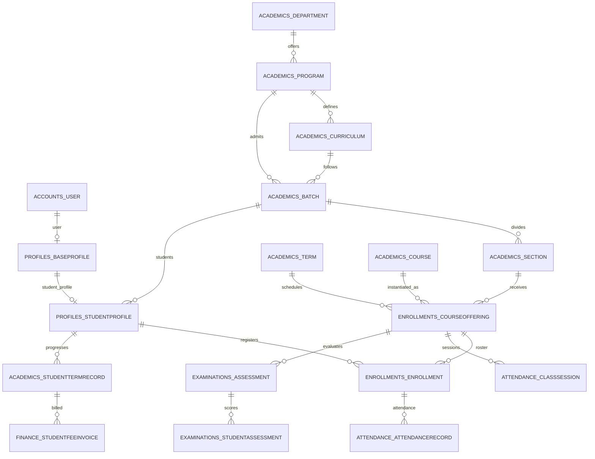

1. Define departments, programs, courses, prerequisites, and curricula.
2. Admit a batch against a program, curriculum, and admission term, then create sections.
3. Create a user and base profile, and attach a student profile to a batch and optionally a section.
4. Offer a course to a section in a term. Assign faculty and enroll students in that offering.
5. Record class sessions and per-enrollment attendance. Define assessments and per-student marks.
6. Track term progress with `StudentTermRecord` and issue fee invoices against that record. Grading scales define a term's grading rules; SGPA and CGPA are stored summary values rather than SQL-generated columns.

## 4. Tenants and portal configuration

The tenant control plane lives entirely in `default`. A UniversityPortal links the shared portal catalogue to a university; branding, page assets, and domains depend on that pairing.

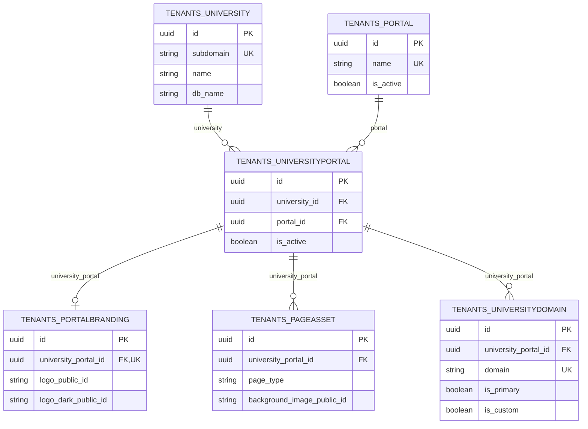

### tenants.University

Main registry entry for an isolated university database. `subdomain` is unique; `db_alias` is a computed property, not a stored field. Database credentials are not stored on this model.

**Table:** `tenants_university` · **Placement:** Main database only

**Source:** [models.py](../apps/tenants/models.py)

| Column | Django type → PostgreSQL | NULL | Keys / indexes | Default and field rules |
| --- | --- | --- | --- | --- |
| `id` | `UUIDField` → `uuid` | no | PK | default `uuid.uuid4` |
| `created_at` | `DateTimeField` → `timestamp with time zone` | no | — | auto_now_add; blank=True |
| `updated_at` | `DateTimeField` → `timestamp with time zone` | no | — | auto_now; blank=True |
| `name` | `CharField` → `varchar(255)` | no | — | — |
| `subdomain` | `SlugField` → `varchar(100)` | no | UNIQUE | — |
| `db_name` | `CharField` → `varchar(255)` | no | — | — |
| `db_host` | `CharField` → `varchar(255)` | no | — | — |
| `db_port` | `CharField` → `varchar(10)` | no | — | default `5432` |
| `is_active` | `BooleanField` → `boolean` | no | — | default `True` |

**Many-to-many fields** (no column on this table)

- `portals` → `tenants.Portal` through `tenants_universityportal`; reverse `universities`.

### tenants.Portal

Shared portal catalogue. The allowed names include student, faculty, admin, and parent; a parent portal does not imply that a ParentProfile model exists.

**Table:** `tenants_portal` · **Placement:** Main database only

**Source:** [models.py](../apps/tenants/models.py)

| Column | Django type → PostgreSQL | NULL | Keys / indexes | Default and field rules |
| --- | --- | --- | --- | --- |
| `id` | `UUIDField` → `uuid` | no | PK | default `uuid.uuid4` |
| `created_at` | `DateTimeField` → `timestamp with time zone` | no | — | auto_now_add; blank=True |
| `updated_at` | `DateTimeField` → `timestamp with time zone` | no | — | auto_now; blank=True |
| `name` | `CharField` → `varchar(50)` | no | UNIQUE | choices: `student`, `faculty`, `admin`, `parent` |
| `is_active` | `BooleanField` → `boolean` | no | — | default `True` |

### tenants.UniversityPortal

Explicit University ↔ Portal join, unique per pair. Child configuration refers to this row so the university and portal cannot be independently mismatched. Post-save signals create branding and a default domain when this row is created through the normal save path.

**Table:** `tenants_universityportal` · **Placement:** Main database only

**Source:** [models.py](../apps/tenants/models.py)

| Column | Django type → PostgreSQL | NULL | Keys / indexes | Default and field rules |
| --- | --- | --- | --- | --- |
| `id` | `UUIDField` → `uuid` | no | PK | default `uuid.uuid4` |
| `created_at` | `DateTimeField` → `timestamp with time zone` | no | — | auto_now_add; blank=True |
| `updated_at` | `DateTimeField` → `timestamp with time zone` | no | — | auto_now; blank=True |
| `university_id` | `ForeignKey` → `uuid` | no | FK, indexed | — |
| `portal_id` | `ForeignKey` → `uuid` | no | FK, indexed | — |
| `is_active` | `BooleanField` → `boolean` | no | — | default `True` |

**Foreign keys and reverse accessors**

- `university` → `tenants.University` (`tenants_university`); `CASCADE`; reverse `university_portals`.
- `portal` → `tenants.Portal` (`tenants_portal`); `CASCADE`; reverse `university_portals`.

**Composite / conditional constraints**

- UNIQUE (`university`, `portal`).

### tenants.PortalBranding

At most one branding configuration per UniversityPortal. Stores Cloudinary public IDs and JSON theme data, not image bytes. `theme_config` can contain colors, typography, border radius, and dark-mode settings; JSON shape validation belongs to the application.

**Table:** `tenants_portalbranding` · **Placement:** Main database only

**Source:** [models.py](../apps/tenants/models.py)

| Column | Django type → PostgreSQL | NULL | Keys / indexes | Default and field rules |
| --- | --- | --- | --- | --- |
| `id` | `UUIDField` → `uuid` | no | PK | default `uuid.uuid4` |
| `created_at` | `DateTimeField` → `timestamp with time zone` | no | — | auto_now_add; blank=True |
| `updated_at` | `DateTimeField` → `timestamp with time zone` | no | — | auto_now; blank=True |
| `university_portal_id` | `OneToOneField` → `uuid` | no | UNIQUE, FK | — |
| `logo_public_id` | `CharField` → `varchar(500)` | no | — | default `''`; blank=True |
| `logo_dark_public_id` | `CharField` → `varchar(500)` | no | — | default `''`; blank=True |
| `favicon_public_id` | `CharField` → `varchar(500)` | no | — | default `''`; blank=True |
| `theme_config` | `JSONField` → `jsonb` | no | — | default `builtins.dict`; blank=True |

**Foreign keys and reverse accessors**

- `university_portal` → `tenants.UniversityPortal` (`tenants_universityportal`); `CASCADE`; reverse `branding`.

**Field meaning**

- `theme_config`: Full theme definition: colors, typography, border radius, dark mode.

### tenants.PageAsset

A page-specific background and JSON metadata for a portal. Uniqueness allows one row for each portal/page-type pair. Metadata may contain a tagline and overlay settings; there is no database JSON schema.

**Table:** `tenants_pageasset` · **Placement:** Main database only

**Source:** [models.py](../apps/tenants/models.py)

| Column | Django type → PostgreSQL | NULL | Keys / indexes | Default and field rules |
| --- | --- | --- | --- | --- |
| `id` | `UUIDField` → `uuid` | no | PK | default `uuid.uuid4` |
| `created_at` | `DateTimeField` → `timestamp with time zone` | no | — | auto_now_add; blank=True |
| `updated_at` | `DateTimeField` → `timestamp with time zone` | no | — | auto_now; blank=True |
| `university_portal_id` | `ForeignKey` → `uuid` | no | FK, indexed | — |
| `page_type` | `CharField` → `varchar(50)` | no | — | choices: `login`, `register`, `forgot_password`, `reset_password`, `dashboard`, `landing` |
| `background_image_public_id` | `CharField` → `varchar(500)` | no | — | default `''`; blank=True |
| `metadata` | `JSONField` → `jsonb` | no | — | default `builtins.dict`; blank=True |

**Foreign keys and reverse accessors**

- `university_portal` → `tenants.UniversityPortal` (`tenants_universityportal`); `CASCADE`; reverse `page_assets`.

**Composite / conditional constraints**

- `UniqueConstraint: fields=('university_portal', 'page_type') name='unique_page_asset_per_portal_page'`.

### tenants.UniversityDomain

Host-to-portal routing and SSL state. Domain strings are globally unique in the main database. The index named `one_primary_per_portal` is a regular composite index, not a unique constraint; it does not enforce a single primary domain.

**Table:** `tenants_universitydomain` · **Placement:** Main database only

**Source:** [models.py](../apps/tenants/models.py)

| Column | Django type → PostgreSQL | NULL | Keys / indexes | Default and field rules |
| --- | --- | --- | --- | --- |
| `id` | `UUIDField` → `uuid` | no | PK | default `uuid.uuid4` |
| `created_at` | `DateTimeField` → `timestamp with time zone` | no | — | auto_now_add; blank=True |
| `updated_at` | `DateTimeField` → `timestamp with time zone` | no | — | auto_now; blank=True |
| `university_portal_id` | `ForeignKey` → `uuid` | no | FK, indexed | — |
| `domain` | `CharField` → `varchar(253)` | no | UNIQUE | — |
| `is_primary` | `BooleanField` → `boolean` | no | — | default `False` |
| `is_custom` | `BooleanField` → `boolean` | no | — | default `False` |
| `ssl_status` | `CharField` → `varchar(20)` | no | — | default `pending`; choices: `pending`, `provisioning`, `active`, `failed`, `expired` |
| `verified_at` | `DateTimeField` → `timestamp with time zone` | yes | — | blank=True |

**Foreign keys and reverse accessors**

- `university_portal` → `tenants.UniversityPortal` (`tenants_universityportal`); `CASCADE`; reverse `domains`.

**Additional indexes**

- `Index: fields=['domain'] name='idx_universitydomain_domain'`.
- `Index: fields=['university_portal', 'is_primary'] name='one_primary_per_portal'`.

**Field meaning**

- `is_primary`: The canonical domain used for redirects and email links.

## 5. Accounts, Django authentication, and authorization

These tables exist independently in the main database and each tenant database. The active custom account replaces `django.contrib.auth.models.User`; there is no `auth_user`, `auth_user_groups`, or `auth_user_user_permissions` table. Django auth migrations still appear in migration history because Group and Permission remain in use.

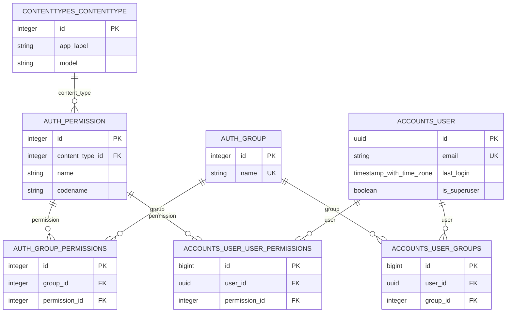

### auth.Permission

Django authorization permission identified by its content type and codename. Standard add/change/delete/view permissions are created by Django post-migration handling. Permission IDs and content-type IDs are database-local.

**Table:** `auth_permission` · **Placement:** Main + each tenant database

| Column | Django type → PostgreSQL | NULL | Keys / indexes | Default and field rules |
| --- | --- | --- | --- | --- |
| `id` | `AutoField` → `integer` | no | PK | blank=True |
| `name` | `CharField` → `varchar(255)` | no | — | — |
| `content_type_id` | `ForeignKey` → `integer` | no | FK, indexed | — |
| `codename` | `CharField` → `varchar(100)` | no | — | — |

**Foreign keys and reverse accessors**

- `content_type` → `contenttypes.ContentType` (`django_content_type`); `CASCADE`; reverse `permission_set`.

**Composite / conditional constraints**

- UNIQUE (`content_type`, `codename`).

**Default ORM ordering:** `content_type__app_label`, `content_type__model`, `codename`. This is query ordering, not physical storage order.

### auth.Group

Django authorization group. Its name is unique within the database. Group membership is many-to-many, so a user can have several roles. Profiles are separate relationships; the database does not automatically equate a group with a profile.

**Table:** `auth_group` · **Placement:** Main + each tenant database

| Column | Django type → PostgreSQL | NULL | Keys / indexes | Default and field rules |
| --- | --- | --- | --- | --- |
| `id` | `AutoField` → `integer` | no | PK | blank=True |
| `name` | `CharField` → `varchar(150)` | no | UNIQUE | — |

**Many-to-many fields** (no column on this table)

- `permissions` → `auth.Permission` through `auth_group_permissions`; reverse `group_set`.

### contenttypes.ContentType

Django model registry row, unique on `(app_label, model)`. Used by permissions and admin logs; a row does not itself prove that the corresponding model table is migrated into this database.

**Table:** `django_content_type` · **Placement:** Main + each tenant database

| Column | Django type → PostgreSQL | NULL | Keys / indexes | Default and field rules |
| --- | --- | --- | --- | --- |
| `id` | `AutoField` → `integer` | no | PK | blank=True |
| `app_label` | `CharField` → `varchar(100)` | no | — | — |
| `model` | `CharField` → `varchar(100)` | no | — | — |

**Composite / conditional constraints**

- UNIQUE (`app_label`, `model`).

### accounts.User

Custom email-login account replacing Django auth.User. Inherits password and last-login fields from AbstractBaseUser, and superuser plus permission relationships from PermissionsMixin. There is no username, date_joined, role column, or university foreign key. Role helpers check group names `student`, `faculty`, and `admin`; `is_staff` separately controls admin-site access.

**Table:** `accounts_user` · **Placement:** Main + each tenant database

**Source:** [models.py](../apps/accounts/models.py)

| Column | Django type → PostgreSQL | NULL | Keys / indexes | Default and field rules |
| --- | --- | --- | --- | --- |
| `password` | `CharField` → `varchar(128)` | no | — | — |
| `last_login` | `DateTimeField` → `timestamp with time zone` | yes | — | blank=True |
| `is_superuser` | `BooleanField` → `boolean` | no | — | default `False` |
| `id` | `UUIDField` → `uuid` | no | PK | default `uuid.uuid4` |
| `created_at` | `DateTimeField` → `timestamp with time zone` | no | — | auto_now_add; blank=True |
| `updated_at` | `DateTimeField` → `timestamp with time zone` | no | — | auto_now; blank=True |
| `email` | `EmailField` → `varchar(254)` | no | UNIQUE | — |
| `first_name` | `CharField` → `varchar(150)` | no | — | — |
| `last_name` | `CharField` → `varchar(150)` | no | — | — |
| `is_staff` | `BooleanField` → `boolean` | no | — | default `False` |
| `is_active` | `BooleanField` → `boolean` | no | — | default `True` |

**Many-to-many fields** (no column on this table)

- `groups` → `auth.Group` through `accounts_user_groups`; reverse `user_set`.
- `user_permissions` → `auth.Permission` through `accounts_user_user_permissions`; reverse `user_set`.

### auth.Group_permissions

Django-generated join for permissions granted to a group. The group/permission pair is unique.

**Table:** `auth_group_permissions` · **Placement:** Main + each tenant database · **Auto-created join model**

| Column | Django type → PostgreSQL | NULL | Keys / indexes | Default and field rules |
| --- | --- | --- | --- | --- |
| `id` | `AutoField` → `integer` | no | PK | blank=True |
| `group_id` | `ForeignKey` → `integer` | no | FK, indexed | — |
| `permission_id` | `ForeignKey` → `integer` | no | FK, indexed | — |

**Foreign keys and reverse accessors**

- `group` → `auth.Group` (`auth_group`); `CASCADE`; reverse `Group_permissions+`.
- `permission` → `auth.Permission` (`auth_permission`); `CASCADE`; reverse `Group_permissions+`.

**Composite / conditional constraints**

- UNIQUE (`group`, `permission`).

### accounts.User_groups

Django-generated join for PermissionsMixin.groups. The user/group pair is unique. Its numeric ID is independent of the UUID user key.

**Table:** `accounts_user_groups` · **Placement:** Main + each tenant database · **Auto-created join model**

**Source:** [models.py](../apps/accounts/models.py)

| Column | Django type → PostgreSQL | NULL | Keys / indexes | Default and field rules |
| --- | --- | --- | --- | --- |
| `id` | `BigAutoField` → `bigint` | no | PK | blank=True |
| `user_id` | `ForeignKey` → `uuid` | no | FK, indexed | — |
| `group_id` | `ForeignKey` → `integer` | no | FK, indexed | — |

**Foreign keys and reverse accessors**

- `user` → `accounts.User` (`accounts_user`); `CASCADE`; reverse `User_groups+`.
- `group` → `auth.Group` (`auth_group`); `CASCADE`; reverse `User_groups+`.

**Composite / conditional constraints**

- UNIQUE (`user`, `group`).

### accounts.User_user_permissions

Django-generated join for direct permissions assigned to a user. The user/permission pair is unique; group-derived permissions use Group_permissions instead.

**Table:** `accounts_user_user_permissions` · **Placement:** Main + each tenant database · **Auto-created join model**

**Source:** [models.py](../apps/accounts/models.py)

| Column | Django type → PostgreSQL | NULL | Keys / indexes | Default and field rules |
| --- | --- | --- | --- | --- |
| `id` | `BigAutoField` → `bigint` | no | PK | blank=True |
| `user_id` | `ForeignKey` → `uuid` | no | FK, indexed | — |
| `permission_id` | `ForeignKey` → `integer` | no | FK, indexed | — |

**Foreign keys and reverse accessors**

- `user` → `accounts.User` (`accounts_user`); `CASCADE`; reverse `User_user_permissions+`.
- `permission` → `auth.Permission` (`auth_permission`); `CASCADE`; reverse `User_user_permissions+`.

**Composite / conditional constraints**

- UNIQUE (`user`, `permission`).

## 6. Profiles and documents

Profiles are tenant-local. A User can have a BaseProfile, and a BaseProfile can independently have student, faculty, and admin profiles. These are concrete one-to-one tables, not Django multi-table inheritance.

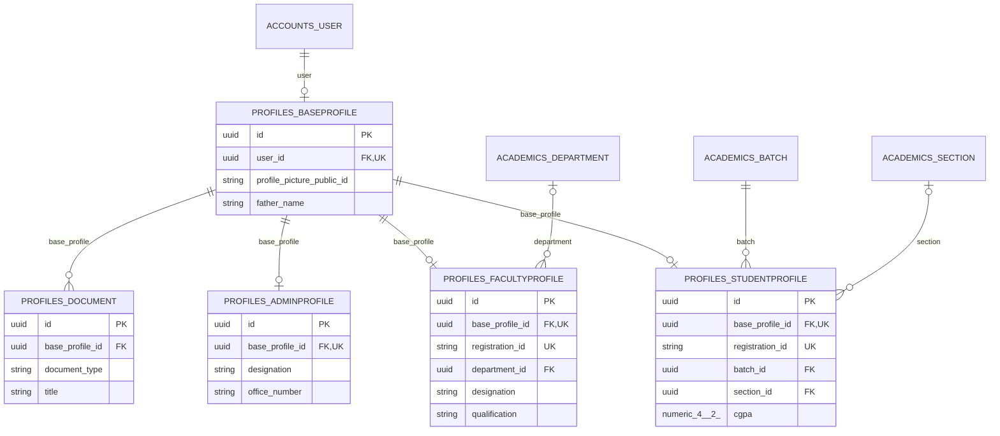

### profiles.BaseProfile

Concrete shared personal/contact profile, with at most one row per user. Despite its name, this is not abstract. Each role profile has its own one-to-one relationship to this profile, allowing multiple role-profile types for the same person.

**Table:** `profiles_baseprofile` · **Placement:** Each tenant database only

**Source:** [models.py](../apps/profiles/models.py)

| Column | Django type → PostgreSQL | NULL | Keys / indexes | Default and field rules |
| --- | --- | --- | --- | --- |
| `id` | `UUIDField` → `uuid` | no | PK | default `uuid.uuid4` |
| `created_at` | `DateTimeField` → `timestamp with time zone` | no | — | auto_now_add; blank=True |
| `updated_at` | `DateTimeField` → `timestamp with time zone` | no | — | auto_now; blank=True |
| `user_id` | `OneToOneField` → `uuid` | no | UNIQUE, FK | — |
| `profile_picture_public_id` | `CharField` → `varchar(255)` | yes | — | blank=True |
| `father_name` | `CharField` → `varchar(150)` | yes | — | blank=True |
| `date_of_birth` | `DateField` → `date` | yes | — | blank=True |
| `gender` | `CharField` → `varchar(10)` | yes | — | blank=True; choices: `male`, `female`, `other` |
| `nationality` | `CharField` → `varchar(100)` | yes | — | blank=True |
| `cnic` | `CharField` → `varchar(15)` | yes | — | blank=True |
| `religion` | `CharField` → `varchar(50)` | yes | — | blank=True |
| `phone_number` | `CharField` → `varchar(20)` | yes | — | blank=True |
| `emergency_contact` | `CharField` → `varchar(20)` | yes | — | blank=True |
| `address` | `TextField` → `text` | yes | — | blank=True |
| `city` | `CharField` → `varchar(100)` | yes | — | blank=True |
| `country` | `CharField` → `varchar(100)` | yes | — | blank=True |
| `bio` | `TextField` → `text` | yes | — | blank=True |

**Foreign keys and reverse accessors**

- `user` → `accounts.User` (`accounts_user`); `CASCADE`; reverse `base_profile`.

### profiles.StudentProfile

Student identity and current academic placement. Registration ID is unique within the tenant. Batch is required; section is optional. CGPA is a stored decimal summary. Batch/section deletion is protected while referenced.

**Table:** `profiles_studentprofile` · **Placement:** Each tenant database only

**Source:** [models.py](../apps/profiles/models.py)

| Column | Django type → PostgreSQL | NULL | Keys / indexes | Default and field rules |
| --- | --- | --- | --- | --- |
| `id` | `UUIDField` → `uuid` | no | PK | default `uuid.uuid4` |
| `created_at` | `DateTimeField` → `timestamp with time zone` | no | — | auto_now_add; blank=True |
| `updated_at` | `DateTimeField` → `timestamp with time zone` | no | — | auto_now; blank=True |
| `base_profile_id` | `OneToOneField` → `uuid` | no | UNIQUE, FK | — |
| `registration_id` | `CharField` → `varchar(50)` | no | UNIQUE | — |
| `batch_id` | `ForeignKey` → `uuid` | no | FK, indexed | — |
| `section_id` | `ForeignKey` → `uuid` | yes | FK, indexed | blank=True |
| `cgpa` | `DecimalField` → `numeric(4, 2)` | no | — | default `0.0` |

**Foreign keys and reverse accessors**

- `base_profile` → `profiles.BaseProfile` (`profiles_baseprofile`); `CASCADE`; reverse `student_profile`.
- `batch` → `academics.Batch` (`academics_batch`); `PROTECT`; reverse `students`.
- `section` → `academics.Section` (`academics_section`); `PROTECT`; reverse `students`.

### profiles.FacultyProfile

Faculty identity, qualifications, office details, department, and teaching credit limits. Department membership is optional and becomes NULL on department deletion. `Department.head_of_department` is a separate one-to-one relationship.

**Table:** `profiles_facultyprofile` · **Placement:** Each tenant database only

**Source:** [models.py](../apps/profiles/models.py)

| Column | Django type → PostgreSQL | NULL | Keys / indexes | Default and field rules |
| --- | --- | --- | --- | --- |
| `id` | `UUIDField` → `uuid` | no | PK | default `uuid.uuid4` |
| `created_at` | `DateTimeField` → `timestamp with time zone` | no | — | auto_now_add; blank=True |
| `updated_at` | `DateTimeField` → `timestamp with time zone` | no | — | auto_now; blank=True |
| `base_profile_id` | `OneToOneField` → `uuid` | no | UNIQUE, FK | — |
| `registration_id` | `CharField` → `varchar(50)` | no | UNIQUE | — |
| `designation` | `CharField` → `varchar(150)` | yes | — | blank=True |
| `qualification` | `CharField` → `varchar(255)` | yes | — | blank=True |
| `specialization` | `CharField` → `varchar(255)` | yes | — | blank=True |
| `experience_years` | `PositiveIntegerField` → `integer` | yes | — | blank=True |
| `office_number` | `CharField` → `varchar(20)` | yes | — | blank=True |
| `office_location` | `CharField` → `varchar(150)` | yes | — | blank=True |
| `department_id` | `ForeignKey` → `uuid` | yes | FK, indexed | blank=True |
| `max_credits_per_term` | `PositiveIntegerField` → `integer` | no | — | default `12` |
| `min_credits_per_term` | `PositiveIntegerField` → `integer` | no | — | default `6` |

**Foreign keys and reverse accessors**

- `base_profile` → `profiles.BaseProfile` (`profiles_baseprofile`); `CASCADE`; reverse `faculty_profile`.
- `department` → `academics.Department` (`academics_department`); `SET_NULL`; reverse `faculty_members`.

### profiles.AdminProfile

Role-specific administrative designation and office details. Authorization still comes from User flags, groups, and permissions.

**Table:** `profiles_adminprofile` · **Placement:** Each tenant database only

**Source:** [models.py](../apps/profiles/models.py)

| Column | Django type → PostgreSQL | NULL | Keys / indexes | Default and field rules |
| --- | --- | --- | --- | --- |
| `id` | `UUIDField` → `uuid` | no | PK | default `uuid.uuid4` |
| `created_at` | `DateTimeField` → `timestamp with time zone` | no | — | auto_now_add; blank=True |
| `updated_at` | `DateTimeField` → `timestamp with time zone` | no | — | auto_now; blank=True |
| `base_profile_id` | `OneToOneField` → `uuid` | no | UNIQUE, FK | — |
| `designation` | `CharField` → `varchar(150)` | yes | — | blank=True |
| `office_number` | `CharField` → `varchar(20)` | yes | — | blank=True |
| `office_location` | `CharField` → `varchar(150)` | yes | — | blank=True |

**Foreign keys and reverse accessors**

- `base_profile` → `profiles.BaseProfile` (`profiles_baseprofile`); `CASCADE`; reverse `admin_profile`.

### profiles.Document

Private Cloudinary document metadata attached to a BaseProfile. Stores a public ID and resource type; file contents and signed delivery URLs are not database columns. Document type is a choice, but no unique-per-type restriction exists. Verification is a Boolean without a verifier foreign key.

**Table:** `profiles_document` · **Placement:** Each tenant database only

**Source:** [models.py](../apps/profiles/models.py)

| Column | Django type → PostgreSQL | NULL | Keys / indexes | Default and field rules |
| --- | --- | --- | --- | --- |
| `id` | `UUIDField` → `uuid` | no | PK | default `uuid.uuid4` |
| `created_at` | `DateTimeField` → `timestamp with time zone` | no | — | auto_now_add; blank=True |
| `updated_at` | `DateTimeField` → `timestamp with time zone` | no | — | auto_now; blank=True |
| `base_profile_id` | `ForeignKey` → `uuid` | no | FK, indexed | — |
| `document_type` | `CharField` → `varchar(50)` | no | — | choices: `matric_result`, `fsc_result`, `bachelor_degree`, `transcript`, `admission_letter`, `phd_degree`, `master_degree`, `experience_letter`, `research_paper`, `appointment_letter`, `cnic`, `passport`, `other` |
| `title` | `CharField` → `varchar(255)` | no | — | — |
| `resource_type` | `CharField` → `varchar(20)` | no | — | default `raw` |
| `description` | `TextField` → `text` | yes | — | blank=True |
| `is_verified` | `BooleanField` → `boolean` | no | — | default `False` |
| `document_public_id` | `CharField` → `varchar(255)` | yes | — | blank=True |

**Foreign keys and reverse accessors**

- `base_profile` → `profiles.BaseProfile` (`profiles_baseprofile`); `CASCADE`; reverse `documents`.

## 7. Academic structure and progress

The catalogue defines programs, courses, and curricula. Operational academic data adds years, terms, cohorts, sections, and per-student term summaries. All relationships in this section stay within a tenant database.

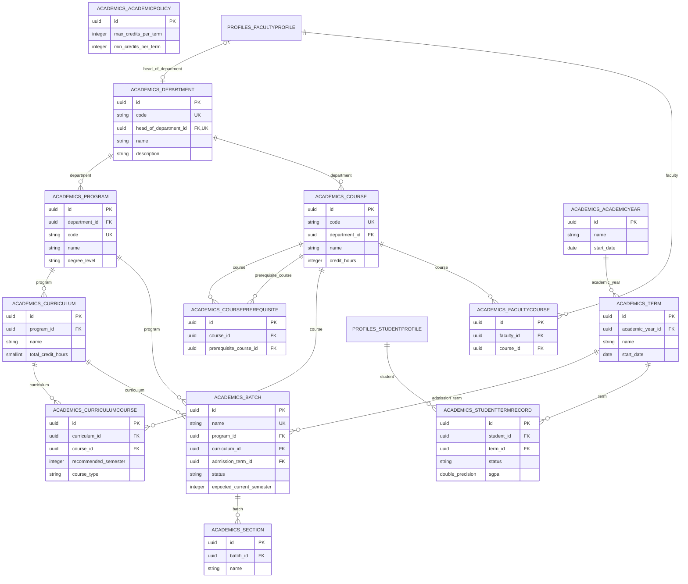

### academics.AcademicPolicy

University-level minimum/maximum term credits. Intended as a singleton; clean() validates minimum ≤ maximum and save() calls full_clean(). The UUID primary key has a default, so the `if not self.pk` creation guard does not reliably prevent additional rows. There is no database singleton constraint.

**Table:** `academics_academicpolicy` · **Placement:** Each tenant database only

**Source:** [models.py](../apps/academics/models.py)

| Column | Django type → PostgreSQL | NULL | Keys / indexes | Default and field rules |
| --- | --- | --- | --- | --- |
| `id` | `UUIDField` → `uuid` | no | PK | default `uuid.uuid4` |
| `created_at` | `DateTimeField` → `timestamp with time zone` | no | — | auto_now_add; blank=True |
| `updated_at` | `DateTimeField` → `timestamp with time zone` | no | — | auto_now; blank=True |
| `max_credits_per_term` | `PositiveIntegerField` → `integer` | no | — | default `21` |
| `min_credits_per_term` | `PositiveIntegerField` → `integer` | no | — | default `12` |

### academics.Department

Department catalogue with unique code. Optional head_of_department is one-to-one, so a faculty member can head at most one department. This relationship does not require that the faculty member belongs to that department.

**Table:** `academics_department` · **Placement:** Each tenant database only

**Source:** [models.py](../apps/academics/models.py)

| Column | Django type → PostgreSQL | NULL | Keys / indexes | Default and field rules |
| --- | --- | --- | --- | --- |
| `id` | `UUIDField` → `uuid` | no | PK | default `uuid.uuid4` |
| `created_at` | `DateTimeField` → `timestamp with time zone` | no | — | auto_now_add; blank=True |
| `updated_at` | `DateTimeField` → `timestamp with time zone` | no | — | auto_now; blank=True |
| `name` | `CharField` → `varchar(255)` | no | — | — |
| `code` | `CharField` → `varchar(50)` | no | UNIQUE | — |
| `description` | `TextField` → `text` | no | — | blank=True |
| `head_of_department_id` | `OneToOneField` → `uuid` | yes | UNIQUE, FK | blank=True |

**Foreign keys and reverse accessors**

- `head_of_department` → `profiles.FacultyProfile` (`profiles_facultyprofile`); `SET_NULL`; reverse `headed_department`.

**Field meaning**

- `code`: Unique code for the department (e.g., CS, Management, etc.)

### academics.Program

Degree programme owned by a department. Stores overall fee, credit requirements, semester count, and admission capacity. Capacity and totals are scalar configuration values rather than derived aggregates.

**Table:** `academics_program` · **Placement:** Each tenant database only

**Source:** [models.py](../apps/academics/models.py)

| Column | Django type → PostgreSQL | NULL | Keys / indexes | Default and field rules |
| --- | --- | --- | --- | --- |
| `id` | `UUIDField` → `uuid` | no | PK | default `uuid.uuid4` |
| `created_at` | `DateTimeField` → `timestamp with time zone` | no | — | auto_now_add; blank=True |
| `updated_at` | `DateTimeField` → `timestamp with time zone` | no | — | auto_now; blank=True |
| `department_id` | `ForeignKey` → `uuid` | no | FK, indexed | — |
| `name` | `CharField` → `varchar(255)` | no | — | — |
| `code` | `CharField` → `varchar(50)` | no | UNIQUE | — |
| `degree_level` | `CharField` → `varchar(3)` | no | — | choices: `UG`, `PG`, `PHD`, `DIP` |
| `total_fee` | `DecimalField` → `numeric(10, 2)` | no | — | — |
| `total_credit_hours_required` | `PositiveIntegerField` → `integer` | no | — | — |
| `number_of_semesters` | `PositiveIntegerField` → `integer` | no | — | validators: `MinValueValidator(1)` |
| `per_batch_capacity` | `PositiveIntegerField` → `integer` | no | — | — |

**Foreign keys and reverse accessors**

- `department` → `academics.Department` (`academics_department`); `CASCADE`; reverse `programs`.

**Field meaning**

- `code`: Unique code for the program (e.g., BSCS, MBA, etc.)
- `per_batch_capacity`: Maximum number of students that can be admitted in a Batch Allowed by HEC.

### academics.Course

Department-owned course catalogue with a unique code. Prerequisites are a directed self many-to-many relationship through CoursePrerequisite. There is no automatic symmetric reverse prerequisite.

**Table:** `academics_course` · **Placement:** Each tenant database only

**Source:** [models.py](../apps/academics/models.py)

| Column | Django type → PostgreSQL | NULL | Keys / indexes | Default and field rules |
| --- | --- | --- | --- | --- |
| `id` | `UUIDField` → `uuid` | no | PK | default `uuid.uuid4` |
| `created_at` | `DateTimeField` → `timestamp with time zone` | no | — | auto_now_add; blank=True |
| `updated_at` | `DateTimeField` → `timestamp with time zone` | no | — | auto_now; blank=True |
| `name` | `CharField` → `varchar(100)` | no | — | — |
| `code` | `CharField` → `varchar(20)` | no | UNIQUE | — |
| `department_id` | `ForeignKey` → `uuid` | no | FK, indexed | — |
| `credit_hours` | `PositiveIntegerField` → `integer` | no | — | validators: `MinValueValidator(1)`, `MaxValueValidator(10)` |
| `description` | `TextField` → `text` | no | — | — |

**Foreign keys and reverse accessors**

- `department` → `academics.Department` (`academics_department`); `CASCADE`; reverse `courses`.

**Many-to-many fields** (no column on this table)

- `prerequisites` → `academics.Course` through `academics_courseprerequisite`; reverse `prerequisite_for` ; directed (`symmetrical=False`).

### academics.CoursePrerequisite

Directed requirement edge: `course` requires `prerequisite_course`. Pair uniqueness prevents duplicate edges; the schema does not prohibit self-edges or prerequisite cycles.

**Table:** `academics_courseprerequisite` · **Placement:** Each tenant database only

**Source:** [models.py](../apps/academics/models.py)

| Column | Django type → PostgreSQL | NULL | Keys / indexes | Default and field rules |
| --- | --- | --- | --- | --- |
| `id` | `UUIDField` → `uuid` | no | PK | default `uuid.uuid4` |
| `created_at` | `DateTimeField` → `timestamp with time zone` | no | — | auto_now_add; blank=True |
| `updated_at` | `DateTimeField` → `timestamp with time zone` | no | — | auto_now; blank=True |
| `course_id` | `ForeignKey` → `uuid` | no | FK, indexed | — |
| `prerequisite_course_id` | `ForeignKey` → `uuid` | no | FK, indexed | — |

**Foreign keys and reverse accessors**

- `course` → `academics.Course` (`academics_course`); `CASCADE`; reverse `course_requirements`.
- `prerequisite_course` → `academics.Course` (`academics_course`); `CASCADE`; reverse `required_for`.

**Composite / conditional constraints**

- UNIQUE (`course`, `prerequisite_course`).

### academics.Curriculum

A program curriculum with its own name, total credits, and description. Curriculum versioning/effective dates are not currently stored.

**Table:** `academics_curriculum` · **Placement:** Each tenant database only

**Source:** [models.py](../apps/academics/models.py)

| Column | Django type → PostgreSQL | NULL | Keys / indexes | Default and field rules |
| --- | --- | --- | --- | --- |
| `id` | `UUIDField` → `uuid` | no | PK | default `uuid.uuid4` |
| `created_at` | `DateTimeField` → `timestamp with time zone` | no | — | auto_now_add; blank=True |
| `updated_at` | `DateTimeField` → `timestamp with time zone` | no | — | auto_now; blank=True |
| `name` | `CharField` → `varchar(100)` | no | — | — |
| `program_id` | `ForeignKey` → `uuid` | no | FK, indexed | — |
| `total_credit_hours` | `PositiveSmallIntegerField` → `smallint` | no | — | — |
| `description` | `TextField` → `text` | no | — | blank=True |

**Foreign keys and reverse accessors**

- `program` → `academics.Program` (`academics_program`); `CASCADE`; reverse `curriculums`.

### academics.CurriculumCourse

Course membership in a curriculum with recommended semester and category. A course can occur only once per curriculum. Recommended semester is not part of the unique key.

**Table:** `academics_curriculumcourse` · **Placement:** Each tenant database only

**Source:** [models.py](../apps/academics/models.py)

| Column | Django type → PostgreSQL | NULL | Keys / indexes | Default and field rules |
| --- | --- | --- | --- | --- |
| `id` | `UUIDField` → `uuid` | no | PK | default `uuid.uuid4` |
| `created_at` | `DateTimeField` → `timestamp with time zone` | no | — | auto_now_add; blank=True |
| `updated_at` | `DateTimeField` → `timestamp with time zone` | no | — | auto_now; blank=True |
| `curriculum_id` | `ForeignKey` → `uuid` | no | FK, indexed | — |
| `course_id` | `ForeignKey` → `uuid` | no | FK, indexed | — |
| `recommended_semester` | `PositiveIntegerField` → `integer` | no | — | — |
| `course_type` | `CharField` → `varchar(4)` | no | — | default `CORE`; choices: `CORE`, `ELEC`, `GEN` |

**Foreign keys and reverse accessors**

- `curriculum` → `academics.Curriculum` (`academics_curriculum`); `CASCADE`; reverse `courses`.
- `course` → `academics.Course` (`academics_course`); `CASCADE`; reverse `curriculum_courses`.

**Composite / conditional constraints**

- `UniqueConstraint: fields=('curriculum', 'course') name='unique_course_in_curriculum'`.

### academics.FacultyCourse

Faculty-to-course eligibility/availability join. A unique pair indicates a faculty member can teach that course; actual term delivery is recorded by FacultyAssignment.

**Table:** `academics_facultycourse` · **Placement:** Each tenant database only

**Source:** [models.py](../apps/academics/models.py)

| Column | Django type → PostgreSQL | NULL | Keys / indexes | Default and field rules |
| --- | --- | --- | --- | --- |
| `id` | `UUIDField` → `uuid` | no | PK | default `uuid.uuid4` |
| `created_at` | `DateTimeField` → `timestamp with time zone` | no | — | auto_now_add; blank=True |
| `updated_at` | `DateTimeField` → `timestamp with time zone` | no | — | auto_now; blank=True |
| `faculty_id` | `ForeignKey` → `uuid` | no | FK, indexed | — |
| `course_id` | `ForeignKey` → `uuid` | no | FK, indexed | — |

**Foreign keys and reverse accessors**

- `faculty` → `profiles.FacultyProfile` (`profiles_facultyprofile`); `CASCADE`; reverse `teach_courses`.
- `course` → `academics.Course` (`academics_course`); `CASCADE`; reverse `available_faculty`.

**Composite / conditional constraints**

- `UniqueConstraint: fields=('faculty', 'course') name='unique_faculty_course_assignment'`.

### academics.AcademicYear

Named date range grouping terms. The name is not unique and the schema does not limit is_active=True to one academic year.

**Table:** `academics_academicyear` · **Placement:** Each tenant database only

**Source:** [models.py](../apps/academics/models.py)

| Column | Django type → PostgreSQL | NULL | Keys / indexes | Default and field rules |
| --- | --- | --- | --- | --- |
| `id` | `UUIDField` → `uuid` | no | PK | default `uuid.uuid4` |
| `created_at` | `DateTimeField` → `timestamp with time zone` | no | — | auto_now_add; blank=True |
| `updated_at` | `DateTimeField` → `timestamp with time zone` | no | — | auto_now; blank=True |
| `name` | `CharField` → `varchar(20)` | no | — | — |
| `start_date` | `DateField` → `date` | no | — | — |
| `end_date` | `DateField` → `date` | no | — | — |
| `is_active` | `BooleanField` → `boolean` | no | — | default `False` |

### academics.Term

Academic calendar and operational deadlines within an academic year. A partial unique constraint permits at most one active term per tenant. Registration/assignment/drop/withdraw helpers calculate windows from these stored dates; date ordering is not checked by database constraints.

**Table:** `academics_term` · **Placement:** Each tenant database only

**Source:** [models.py](../apps/academics/models.py)

| Column | Django type → PostgreSQL | NULL | Keys / indexes | Default and field rules |
| --- | --- | --- | --- | --- |
| `id` | `UUIDField` → `uuid` | no | PK | default `uuid.uuid4` |
| `created_at` | `DateTimeField` → `timestamp with time zone` | no | — | auto_now_add; blank=True |
| `updated_at` | `DateTimeField` → `timestamp with time zone` | no | — | auto_now; blank=True |
| `name` | `CharField` → `varchar(50)` | no | — | — |
| `academic_year_id` | `ForeignKey` → `uuid` | no | FK, indexed | — |
| `start_date` | `DateField` → `date` | no | — | — |
| `end_date` | `DateField` → `date` | no | — | — |
| `term_type` | `CharField` → `varchar(10)` | no | — | choices: `FALL`, `SPRING`, `SUMMER`, `WINTER` |
| `is_active` | `BooleanField` → `boolean` | no | — | default `False` |
| `fee_issue_date` | `DateField` → `date` | no | — | — |
| `fee_deadline` | `DateField` → `date` | no | — | — |
| `faculty_course_assignment_start_date` | `DateField` → `date` | no | — | — |
| `faculty_course_assignment_end_date` | `DateField` → `date` | no | — | — |
| `course_registration_start_date` | `DateField` → `date` | no | — | — |
| `course_registration_end_date` | `DateField` → `date` | no | — | — |
| `course_drop_deadline` | `DateField` → `date` | no | — | — |
| `course_withdraw_deadline` | `DateField` → `date` | no | — | — |

**Foreign keys and reverse accessors**

- `academic_year` → `academics.AcademicYear` (`academics_academicyear`); `CASCADE`; reverse `terms`.

**Composite / conditional constraints**

- `UniqueConstraint: fields=('is_active',) name='unique_active_term' condition=(AND: ('is_active', True))`.

### academics.Batch

Admission cohort tied to a program, protected curriculum, and protected admission term. Both the batch name and the program/admission-term pair are unique. Expected semester and per-section capacity are stored configuration.

**Table:** `academics_batch` · **Placement:** Each tenant database only

**Source:** [models.py](../apps/academics/models.py)

| Column | Django type → PostgreSQL | NULL | Keys / indexes | Default and field rules |
| --- | --- | --- | --- | --- |
| `id` | `UUIDField` → `uuid` | no | PK | default `uuid.uuid4` |
| `created_at` | `DateTimeField` → `timestamp with time zone` | no | — | auto_now_add; blank=True |
| `updated_at` | `DateTimeField` → `timestamp with time zone` | no | — | auto_now; blank=True |
| `name` | `CharField` → `varchar(55)` | no | UNIQUE | — |
| `program_id` | `ForeignKey` → `uuid` | no | FK, indexed | — |
| `curriculum_id` | `ForeignKey` → `uuid` | no | FK, indexed | — |
| `admission_term_id` | `ForeignKey` → `uuid` | no | FK, indexed | — |
| `status` | `CharField` → `varchar(20)` | no | — | default `ACTIVE`; choices: `ACTIVE`, `INACTIVE`, `GRADUATED` |
| `expected_current_semester` | `PositiveIntegerField` → `integer` | no | — | default `1`; validators: `MinValueValidator(1)` |
| `per_section_capacity` | `PositiveIntegerField` → `integer` | no | — | validators: `MinValueValidator(1)` |

**Foreign keys and reverse accessors**

- `program` → `academics.Program` (`academics_program`); `CASCADE`; reverse `batch_set`.
- `curriculum` → `academics.Curriculum` (`academics_curriculum`); `PROTECT`; reverse `batch_set`.
- `admission_term` → `academics.Term` (`academics_term`); `PROTECT`; reverse `admitted_batches`.

**Composite / conditional constraints**

- `UniqueConstraint: fields=('program', 'admission_term') name='unique_batch_per_program_term'`.

**Field meaning**

- `expected_current_semester`: Current semester number for the batch. Help admin and system to get the current semester of the batch. This will be used to determine which courses are offered to the students of this batch.
- `per_section_capacity`: Maximum number of students allowed in a section for this batch. This will be used to determine how many sections are created for the batch.

### academics.Section

Section within a batch. There is no uniqueness constraint on name or `(batch, name)`.

**Table:** `academics_section` · **Placement:** Each tenant database only

**Source:** [models.py](../apps/academics/models.py)

| Column | Django type → PostgreSQL | NULL | Keys / indexes | Default and field rules |
| --- | --- | --- | --- | --- |
| `id` | `UUIDField` → `uuid` | no | PK | default `uuid.uuid4` |
| `created_at` | `DateTimeField` → `timestamp with time zone` | no | — | auto_now_add; blank=True |
| `updated_at` | `DateTimeField` → `timestamp with time zone` | no | — | auto_now; blank=True |
| `name` | `CharField` → `varchar(10)` | no | — | — |
| `batch_id` | `ForeignKey` → `uuid` | no | FK, indexed | — |

**Foreign keys and reverse accessors**

- `batch` → `academics.Batch` (`academics_batch`); `CASCADE`; reverse `sections`.

### academics.StudentTermRecord

Per-student, per-term summary, unique on that pair. Stores SGPA, enrollment/progression status, and academic standing. `sgpa` is a floating-point field, unlike StudentProfile.cgpa, which is decimal.

**Table:** `academics_studenttermrecord` · **Placement:** Each tenant database only

**Source:** [models.py](../apps/academics/models.py)

| Column | Django type → PostgreSQL | NULL | Keys / indexes | Default and field rules |
| --- | --- | --- | --- | --- |
| `id` | `UUIDField` → `uuid` | no | PK | default `uuid.uuid4` |
| `created_at` | `DateTimeField` → `timestamp with time zone` | no | — | auto_now_add; blank=True |
| `updated_at` | `DateTimeField` → `timestamp with time zone` | no | — | auto_now; blank=True |
| `student_id` | `ForeignKey` → `uuid` | no | FK, indexed | — |
| `term_id` | `ForeignKey` → `uuid` | no | FK, indexed | — |
| `status` | `CharField` → `varchar(20)` | no | — | default `ENROLLED`; choices: `ENROLLED`, `COMPLETED`, `DROPPED_OUT`, `FAILED` |
| `sgpa` | `FloatField` → `double precision` | no | — | default `0.0` |
| `academic_standing` | `CharField` → `varchar(30)` | yes | — | default `GOOD`; blank=True; choices: `GOOD`, `PROBATION`, `SUSPENDED`, `EXPELLED` |

**Foreign keys and reverse accessors**

- `student` → `profiles.StudentProfile` (`profiles_studentprofile`); `CASCADE`; reverse `term_records`.
- `term` → `academics.Term` (`academics_term`); `CASCADE`; reverse `studenttermrecord_set`.

**Composite / conditional constraints**

- `UniqueConstraint: fields=('student', 'term') name='unique_student_term_record'`.

**Field meaning**

- `academic_standing`: Academic standing based on GPA (e.g., Good, Probation, etc.)

## 8. Course delivery and enrollments

CourseOffering is the delivery hub. FacultyAssignment connects instructors to that hub; Enrollment connects students. This distinguishes a catalogue Course from an actual class in a term and section.

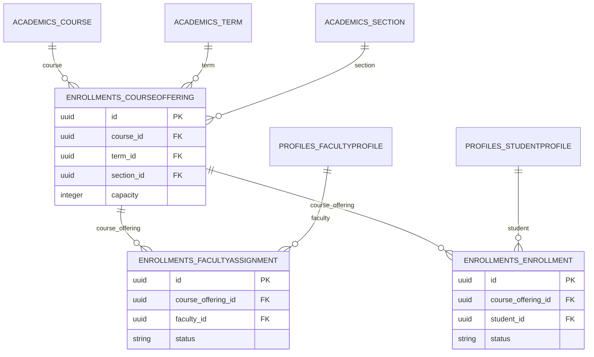

### enrollments.CourseOffering

Concrete course + term + section combination, unique on those three foreign keys. Capacity defaults to 30. The schema does not enforce roster counts against this value.

**Table:** `enrollments_courseoffering` · **Placement:** Each tenant database only

**Source:** [models.py](../apps/enrollments/models.py)

| Column | Django type → PostgreSQL | NULL | Keys / indexes | Default and field rules |
| --- | --- | --- | --- | --- |
| `id` | `UUIDField` → `uuid` | no | PK | default `uuid.uuid4` |
| `created_at` | `DateTimeField` → `timestamp with time zone` | no | — | auto_now_add; blank=True |
| `updated_at` | `DateTimeField` → `timestamp with time zone` | no | — | auto_now; blank=True |
| `course_id` | `ForeignKey` → `uuid` | no | FK, indexed | — |
| `term_id` | `ForeignKey` → `uuid` | no | FK, indexed | — |
| `section_id` | `ForeignKey` → `uuid` | no | FK, indexed | — |
| `capacity` | `PositiveIntegerField` → `integer` | no | — | default `30` |

**Foreign keys and reverse accessors**

- `course` → `academics.Course` (`academics_course`); `CASCADE`; reverse `course_offerings`.
- `term` → `academics.Term` (`academics_term`); `CASCADE`; reverse `course_offerings`.
- `section` → `academics.Section` (`academics_section`); `CASCADE`; reverse `course_offerings`.

**Composite / conditional constraints**

- `UniqueConstraint: fields=('course', 'term', 'section') name='unique_course_offering'`.

### enrollments.FacultyAssignment

Faculty participation in an offering with approval status. A pair is unique; a conditional unique constraint additionally permits at most one approved faculty assignment per offering. Multiple pending/rejected assignments remain possible.

**Table:** `enrollments_facultyassignment` · **Placement:** Each tenant database only

**Source:** [models.py](../apps/enrollments/models.py)

| Column | Django type → PostgreSQL | NULL | Keys / indexes | Default and field rules |
| --- | --- | --- | --- | --- |
| `id` | `UUIDField` → `uuid` | no | PK | default `uuid.uuid4` |
| `created_at` | `DateTimeField` → `timestamp with time zone` | no | — | auto_now_add; blank=True |
| `updated_at` | `DateTimeField` → `timestamp with time zone` | no | — | auto_now; blank=True |
| `course_offering_id` | `ForeignKey` → `uuid` | no | FK, indexed | — |
| `faculty_id` | `ForeignKey` → `uuid` | no | FK, indexed | — |
| `status` | `CharField` → `varchar(20)` | no | — | choices: `pending`, `approved`, `rejected` |

**Foreign keys and reverse accessors**

- `course_offering` → `enrollments.CourseOffering` (`enrollments_courseoffering`); `CASCADE`; reverse `faculty_assignments`.
- `faculty` → `profiles.FacultyProfile` (`profiles_facultyprofile`); `CASCADE`; reverse `assignments`.

**Composite / conditional constraints**

- `UniqueConstraint: fields=('course_offering', 'faculty') name='unique_course_offering_faculty'`.
- `UniqueConstraint: fields=('course_offering',) name='unique_active_assignment_per_offering' condition=(AND: ('status__in', [AssignmentStatus.APPROVED]))`.

### enrollments.Enrollment

Student registration in a CourseOffering, unique per offering/student pair. Dropped/withdrawn/completed states remain on the same row. It does not directly reference StudentTermRecord; term is reachable through course_offering.

**Table:** `enrollments_enrollment` · **Placement:** Each tenant database only

**Source:** [models.py](../apps/enrollments/models.py)

| Column | Django type → PostgreSQL | NULL | Keys / indexes | Default and field rules |
| --- | --- | --- | --- | --- |
| `id` | `UUIDField` → `uuid` | no | PK | default `uuid.uuid4` |
| `created_at` | `DateTimeField` → `timestamp with time zone` | no | — | auto_now_add; blank=True |
| `updated_at` | `DateTimeField` → `timestamp with time zone` | no | — | auto_now; blank=True |
| `course_offering_id` | `ForeignKey` → `uuid` | no | FK, indexed | — |
| `student_id` | `ForeignKey` → `uuid` | no | FK, indexed | — |
| `status` | `CharField` → `varchar(20)` | no | — | default `enrolled`; choices: `enrolled`, `dropped`, `withdrawn`, `completed` |

**Foreign keys and reverse accessors**

- `course_offering` → `enrollments.CourseOffering` (`enrollments_courseoffering`); `CASCADE`; reverse `enrollments`.
- `student` → `profiles.StudentProfile` (`profiles_studentprofile`); `CASCADE`; reverse `enrollments`.

**Composite / conditional constraints**

- `UniqueConstraint: fields=('course_offering', 'student') name='unique_course_offering_student'`.

## 9. Attendance

ClassSession stores a teaching event; AttendanceRecord stores each enrolled student’s status at that event. AttendanceLog stores changes. Current attendance choices are present, absent, and leave. SessionStatus.countable() includes only held; AttendanceStatus.present_equivalent() includes present and leave. Late-related policy columns exist, but there is no late attendance choice.

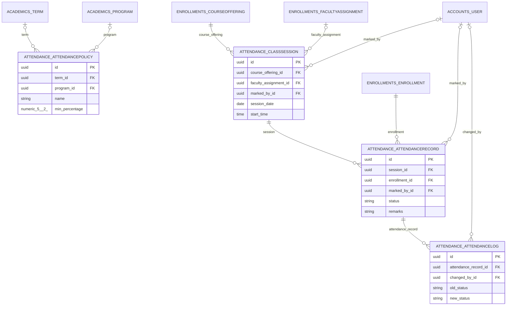

### attendance.AttendancePolicy

Attendance thresholds and edit-window settings, optionally scoped to a term and/or program. Both scope fields NULL represent a tenant-wide fallback. The partial uniqueness constraint covers active pairs but PostgreSQL NULL semantics allow duplicate active scopes containing NULL. The check enforces warning_percentage ≥ min_percentage.

**Table:** `attendance_attendancepolicy` · **Placement:** Each tenant database only

**Source:** [models.py](../apps/attendance/models.py)

| Column | Django type → PostgreSQL | NULL | Keys / indexes | Default and field rules |
| --- | --- | --- | --- | --- |
| `id` | `UUIDField` → `uuid` | no | PK | default `uuid.uuid4` |
| `created_at` | `DateTimeField` → `timestamp with time zone` | no | — | auto_now_add; blank=True |
| `updated_at` | `DateTimeField` → `timestamp with time zone` | no | — | auto_now; blank=True |
| `name` | `CharField` → `varchar(150)` | no | — | — |
| `term_id` | `ForeignKey` → `uuid` | yes | FK, indexed | blank=True |
| `program_id` | `ForeignKey` → `uuid` | yes | FK, indexed | blank=True |
| `min_percentage` | `DecimalField` → `numeric(5, 2)` | no | — | default `75.00`; validators: `MinValueValidator(0)`, `MaxValueValidator(100)` |
| `warning_percentage` | `DecimalField` → `numeric(5, 2)` | no | — | default `80.00`; validators: `MinValueValidator(0)`, `MaxValueValidator(100)` |
| `late_counts_as_present` | `BooleanField` → `boolean` | no | — | default `True` |
| `lates_equal_one_absence` | `PositiveIntegerField` → `integer` | yes | — | blank=True |
| `leave_counts_as_present` | `BooleanField` → `boolean` | no | — | default `True` |
| `faculty_edit_window_days` | `PositiveIntegerField` → `integer` | no | — | default `3` |
| `allow_student_self_marking` | `BooleanField` → `boolean` | no | — | default `False` |
| `is_active` | `BooleanField` → `boolean` | no | — | default `True` |

**Foreign keys and reverse accessors**

- `term` → `academics.Term` (`academics_term`); `CASCADE`; reverse `attendance_policies`.
- `program` → `academics.Program` (`academics_program`); `CASCADE`; reverse `attendance_policies`.

**Composite / conditional constraints**

- `UniqueConstraint: fields=('term', 'program') name='uniq_active_policy_per_term_program' condition=(AND: ('is_active', True))`.
- `CheckConstraint: condition=(AND: ('warning_percentage__gte', F(min_percentage))) name='warning_gte_min_percentage'`.

**Additional indexes**

- `Index: fields=['is_active', 'term', 'program'] name='attendance__is_acti_ae40d1_idx'`.

**Default ORM ordering:** `-created_at`. This is query ordering, not physical storage order.

**Field meaning**

- `name`: e.g. 'University Default 2025' or 'CS Program Override'
- `term_id`: Leave empty to apply to every term.
- `program_id`: Leave empty to apply to every program.
- `min_percentage`: Below this the student is a defaulter (BR11).
- `warning_percentage`: Early-warning threshold shown to students (S3).
- `lates_equal_one_absence`: e.g. 3 => every 3 lates are converted to 1 absence. Empty = disabled.
- `leave_counts_as_present`: BR7 — approved leave is present-equivalent.
- `faculty_edit_window_days`: BR8 — after N days the session auto-locks for faculty.
- `allow_student_self_marking`: Reserved for QR / geofence marking.

### attendance.ClassSession

One scheduled, held, or cancelled teaching period for a course offering. Optional faculty_assignment records the actual teacher; audit user deletion sets marked_by to NULL. The model has indexed date/status fields but no effective Meta ordering, composite indexes, session uniqueness, or end-after-start check: the apparent Meta blocks in the source are at module scope.

**Table:** `attendance_classsession` · **Placement:** Each tenant database only

**Source:** [models.py](../apps/attendance/models.py)

| Column | Django type → PostgreSQL | NULL | Keys / indexes | Default and field rules |
| --- | --- | --- | --- | --- |
| `id` | `UUIDField` → `uuid` | no | PK | default `uuid.uuid4` |
| `created_at` | `DateTimeField` → `timestamp with time zone` | no | — | auto_now_add; blank=True |
| `updated_at` | `DateTimeField` → `timestamp with time zone` | no | — | auto_now; blank=True |
| `course_offering_id` | `ForeignKey` → `uuid` | no | FK, indexed | — |
| `faculty_assignment_id` | `ForeignKey` → `uuid` | yes | FK, indexed | blank=True |
| `session_date` | `DateField` → `date` | no | indexed | — |
| `start_time` | `TimeField` → `time` | yes | — | blank=True |
| `end_time` | `TimeField` → `time` | yes | — | blank=True |
| `duration_minutes` | `PositiveIntegerField` → `integer` | yes | — | blank=True |
| `sequence_number` | `PositiveIntegerField` → `integer` | yes | — | blank=True |
| `session_type` | `CharField` → `varchar(20)` | no | — | default `lecture`; choices: `lecture`, `lab`, `tutorial`, `seminar` |
| `status` | `CharField` → `varchar(20)` | no | indexed | default `scheduled`; choices: `scheduled`, `held`, `cancelled` |
| `topic` | `CharField` → `varchar(255)` | no | — | blank=True |
| `room` | `CharField` → `varchar(50)` | no | — | blank=True |
| `delivery_mode` | `CharField` → `varchar(20)` | no | — | default `onsite`; choices: `onsite`, `online`, `hybrid` |
| `cancellation_reason` | `TextField` → `text` | no | — | blank=True |
| `is_attendance_marked` | `BooleanField` → `boolean` | no | — | default `False` |
| `is_locked` | `BooleanField` → `boolean` | no | — | default `False` |
| `marked_by_id` | `ForeignKey` → `uuid` | yes | FK, indexed | blank=True |
| `marked_at` | `DateTimeField` → `timestamp with time zone` | yes | — | blank=True |

**Foreign keys and reverse accessors**

- `course_offering` → `enrollments.CourseOffering` (`enrollments_courseoffering`); `CASCADE`; reverse `class_sessions`.
- `faculty_assignment` → `enrollments.FacultyAssignment` (`enrollments_facultyassignment`); `SET_NULL`; reverse `class_sessions`.
- `marked_by` → `accounts.User` (`accounts_user`); `SET_NULL`; reverse `marked_class_sessions`.

**Field meaning**

- `course_offering_id`: Which class (term + section + course) this session belongs to. BR2
- `faculty_assignment_id`: Who ACTUALLY taught this session (supports substitutes).
- `session_date`: Local calendar date. DateField (not DateTimeField) on purpose so timezone conversion can never shift a class to another day.
- `duration_minutes`: For weighting: a 3-hour lab may count as 2 sessions.
- `sequence_number`: 1st, 2nd, 3rd lecture of the term. Tiebreaker when start_time is null.
- `status`: BR5 — only HELD is counted in the denominator.
- `topic`: What was covered. Feeds the course file / OBE reports.
- `is_attendance_marked`: Denormalised flag so the compliance report (A3) is ONE cheap query instead of a COUNT per session.
- `is_locked`: BR8 — no more faculty edits.
- `marked_at`: Audit + AI anomaly detection (was this marked 3 weeks late?).

### attendance.AttendanceRecord

One attendance status per session/enrollment pair. The enrollment relation is protected against deletion; the session relation cascades. `counts_as_present` treats present and leave as equivalent. The schema does not verify that the enrollment and session belong to the same offering.

**Table:** `attendance_attendancerecord` · **Placement:** Each tenant database only

**Source:** [models.py](../apps/attendance/models.py)

| Column | Django type → PostgreSQL | NULL | Keys / indexes | Default and field rules |
| --- | --- | --- | --- | --- |
| `id` | `UUIDField` → `uuid` | no | PK | default `uuid.uuid4` |
| `created_at` | `DateTimeField` → `timestamp with time zone` | no | — | auto_now_add; blank=True |
| `updated_at` | `DateTimeField` → `timestamp with time zone` | no | — | auto_now; blank=True |
| `session_id` | `ForeignKey` → `uuid` | no | FK, indexed | — |
| `enrollment_id` | `ForeignKey` → `uuid` | no | FK, indexed | — |
| `status` | `CharField` → `varchar(20)` | no | — | default `absent`; choices: `present`, `absent`, `leave` |
| `remarks` | `CharField` → `varchar(255)` | no | — | blank=True |
| `marked_by_id` | `ForeignKey` → `uuid` | yes | FK, indexed | blank=True |
| `marked_at` | `DateTimeField` → `timestamp with time zone` | yes | — | blank=True |

**Foreign keys and reverse accessors**

- `session` → `attendance.ClassSession` (`attendance_classsession`); `CASCADE`; reverse `attendance_records`.
- `enrollment` → `enrollments.Enrollment` (`enrollments_enrollment`); `PROTECT`; reverse `attendance_records`.
- `marked_by` → `accounts.User` (`accounts_user`); `SET_NULL`; reverse `marked_attendance_records`.

**Composite / conditional constraints**

- `UniqueConstraint: fields=('session', 'enrollment') name='uniq_attendance_per_session_enrollment'`.

**Additional indexes**

- `Index: fields=['enrollment', 'status'] name='idx_record_enrol_status'`.
- `Index: fields=['session', 'status'] name='idx_record_session_status'`.

**Default ORM ordering:** `-session__session_date`. This is query ordering, not physical storage order.

**Field meaning**

- `status`: Default ABSENT on purpose: 'faculty forgot to mark' must never silently become 'everyone present'.

### attendance.AttendanceLog

Attendance-change history with old/new states, actor, timestamp, and reason. Append-only is an application convention: the database allows updates and deletion, and deleting an AttendanceRecord cascades to its logs. No trigger automatically creates log rows.

**Table:** `attendance_attendancelog` · **Placement:** Each tenant database only

**Source:** [models.py](../apps/attendance/models.py)

| Column | Django type → PostgreSQL | NULL | Keys / indexes | Default and field rules |
| --- | --- | --- | --- | --- |
| `id` | `UUIDField` → `uuid` | no | PK | default `uuid.uuid4` |
| `created_at` | `DateTimeField` → `timestamp with time zone` | no | — | auto_now_add; blank=True |
| `updated_at` | `DateTimeField` → `timestamp with time zone` | no | — | auto_now; blank=True |
| `attendance_record_id` | `ForeignKey` → `uuid` | no | FK, indexed | — |
| `old_status` | `CharField` → `varchar(20)` | no | — | blank=True; choices: `present`, `absent`, `leave` |
| `new_status` | `CharField` → `varchar(20)` | no | — | choices: `present`, `absent`, `leave` |
| `changed_by_id` | `ForeignKey` → `uuid` | yes | FK, indexed | blank=True |
| `changed_at` | `DateTimeField` → `timestamp with time zone` | no | indexed | auto_now_add; blank=True |
| `reason` | `CharField` → `varchar(255)` | no | — | blank=True |

**Foreign keys and reverse accessors**

- `attendance_record` → `attendance.AttendanceRecord` (`attendance_attendancerecord`); `CASCADE`; reverse `logs`.
- `changed_by` → `accounts.User` (`accounts_user`); `SET_NULL`; reverse `attendance_changes`.

**Additional indexes**

- `Index: fields=['attendance_record', '-changed_at'] name='idx_log_record_time'`.

**Default ORM ordering:** `-changed_at`. This is query ordering, not physical storage order.

**Field meaning**

- `old_status`: Empty when the record was first created.

## 10. Examinations and grading

AssessmentPolicy configures counts and weights by term/type. Assessment represents the actual offering-level event; StudentAssessment stores a student score. GradePolicy and GradeScale define grade bands separately from the assessment schedule.

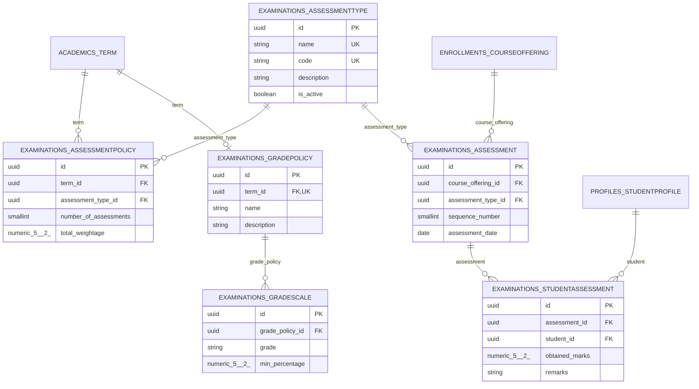

### examinations.AssessmentType

University assessment category such as quiz, assignment, midterm, or final. Both name and system code are independently unique. These are catalogue rows, not a fixed database enum.

**Table:** `examinations_assessmenttype` · **Placement:** Each tenant database only

**Source:** [models.py](../apps/examinations/models.py)

| Column | Django type → PostgreSQL | NULL | Keys / indexes | Default and field rules |
| --- | --- | --- | --- | --- |
| `id` | `UUIDField` → `uuid` | no | PK | default `uuid.uuid4` |
| `created_at` | `DateTimeField` → `timestamp with time zone` | no | — | auto_now_add; blank=True |
| `updated_at` | `DateTimeField` → `timestamp with time zone` | no | — | auto_now; blank=True |
| `name` | `CharField` → `varchar(50)` | no | UNIQUE | — |
| `code` | `CharField` → `varchar(20)` | no | UNIQUE | — |
| `description` | `TextField` → `text` | no | — | blank=True |
| `is_active` | `BooleanField` → `boolean` | no | — | default `True` |

**Default ORM ordering:** `id`. This is query ordering, not physical storage order.

**Field meaning**

- `code`: Unique system code (e.g. QUIZ, ASSIGNMENT, MID, FINAL).

### examinations.AssessmentPolicy

Per-term policy for an assessment type: number of assessments and their combined percentage contribution. Unique per term/type. Validators bound the count and percentage, but there is no database check that all type weights sum to 100.

**Table:** `examinations_assessmentpolicy` · **Placement:** Each tenant database only

**Source:** [models.py](../apps/examinations/models.py)

| Column | Django type → PostgreSQL | NULL | Keys / indexes | Default and field rules |
| --- | --- | --- | --- | --- |
| `id` | `UUIDField` → `uuid` | no | PK | default `uuid.uuid4` |
| `created_at` | `DateTimeField` → `timestamp with time zone` | no | — | auto_now_add; blank=True |
| `updated_at` | `DateTimeField` → `timestamp with time zone` | no | — | auto_now; blank=True |
| `term_id` | `ForeignKey` → `uuid` | no | FK, indexed | — |
| `assessment_type_id` | `ForeignKey` → `uuid` | no | FK, indexed | — |
| `number_of_assessments` | `PositiveSmallIntegerField` → `smallint` | no | — | default `1`; validators: `MinValueValidator(1)` |
| `total_weightage` | `DecimalField` → `numeric(5, 2)` | no | — | validators: `MinValueValidator(0)`, `MaxValueValidator(100)` |

**Foreign keys and reverse accessors**

- `term` → `academics.Term` (`academics_term`); `CASCADE`; reverse `assessment_policies`.
- `assessment_type` → `examinations.AssessmentType` (`examinations_assessmenttype`); `PROTECT`; reverse `policies`.

**Composite / conditional constraints**

- `UniqueConstraint: fields=('term', 'assessment_type') name='unique_assessment_policy'`.

**Default ORM ordering:** `assessment_type`. This is query ordering, not physical storage order.

**Field meaning**

- `number_of_assessments`: Number of assessments (e.g. 4 quizzes, 2 mids).
- `total_weightage`: Overall percentage contribution of this assessment type toward the final course grade.

### examinations.Assessment

An individual numbered assessment for a course offering and type. Unique per offering/type/sequence. Date and total marks may be entered later; marks_submitted records finalization. It has no direct AssessmentPolicy foreign key. The title property suppresses the sequence when the type code is FINAL.

**Table:** `examinations_assessment` · **Placement:** Each tenant database only

**Source:** [models.py](../apps/examinations/models.py)

| Column | Django type → PostgreSQL | NULL | Keys / indexes | Default and field rules |
| --- | --- | --- | --- | --- |
| `id` | `UUIDField` → `uuid` | no | PK | default `uuid.uuid4` |
| `created_at` | `DateTimeField` → `timestamp with time zone` | no | — | auto_now_add; blank=True |
| `updated_at` | `DateTimeField` → `timestamp with time zone` | no | — | auto_now; blank=True |
| `course_offering_id` | `ForeignKey` → `uuid` | no | FK, indexed | — |
| `assessment_type_id` | `ForeignKey` → `uuid` | no | FK, indexed | — |
| `sequence_number` | `PositiveSmallIntegerField` → `smallint` | no | — | validators: `MinValueValidator(1)` |
| `assessment_date` | `DateField` → `date` | yes | — | blank=True |
| `total_marks` | `PositiveIntegerField` → `integer` | yes | — | blank=True; validators: `MinValueValidator(1)` |
| `marks_submitted` | `BooleanField` → `boolean` | no | — | default `False` |

**Foreign keys and reverse accessors**

- `course_offering` → `enrollments.CourseOffering` (`enrollments_courseoffering`); `CASCADE`; reverse `assessments`.
- `assessment_type` → `examinations.AssessmentType` (`examinations_assessmenttype`); `PROTECT`; reverse `assessments`.

**Composite / conditional constraints**

- `UniqueConstraint: fields=('course_offering', 'assessment_type', 'sequence_number') name='unique_assessment_per_course_offering'`.

**Default ORM ordering:** `course_offering`, `assessment_type`, `sequence_number`. This is query ordering, not physical storage order.

**Field meaning**

- `sequence_number`: Sequence number (e.g. Quiz 1, Quiz 2, Mid 1).
- `assessment_date`: Date on which the assessment was conducted.
- `total_marks`: Total marks entered by the faculty.
- `marks_submitted`: Indicates whether the faculty has finalized marks submission.

### examinations.StudentAssessment

Per-assessment score for a StudentProfile, unique per pair. It references the student directly, not Enrollment. A NULL obtained_marks means no score has been stored; the schema does not check enrollment eligibility or obtained_marks ≤ assessment.total_marks.

**Table:** `examinations_studentassessment` · **Placement:** Each tenant database only

**Source:** [models.py](../apps/examinations/models.py)

| Column | Django type → PostgreSQL | NULL | Keys / indexes | Default and field rules |
| --- | --- | --- | --- | --- |
| `id` | `UUIDField` → `uuid` | no | PK | default `uuid.uuid4` |
| `created_at` | `DateTimeField` → `timestamp with time zone` | no | — | auto_now_add; blank=True |
| `updated_at` | `DateTimeField` → `timestamp with time zone` | no | — | auto_now; blank=True |
| `assessment_id` | `ForeignKey` → `uuid` | no | FK, indexed | — |
| `student_id` | `ForeignKey` → `uuid` | no | FK, indexed | — |
| `obtained_marks` | `DecimalField` → `numeric(5, 2)` | yes | — | blank=True; validators: `MinValueValidator(0)` |
| `remarks` | `TextField` → `text` | no | — | blank=True |

**Foreign keys and reverse accessors**

- `assessment` → `examinations.Assessment` (`examinations_assessment`); `CASCADE`; reverse `student_assessments`.
- `student` → `profiles.StudentProfile` (`profiles_studentprofile`); `CASCADE`; reverse `assessment_results`.

**Composite / conditional constraints**

- `UniqueConstraint: fields=('assessment', 'student') name='unique_student_assessment'`.

**Default ORM ordering:** `assessment`, `student`. This is query ordering, not physical storage order.

**Field meaning**

- `obtained_marks`: Marks obtained by the student.

### examinations.GradePolicy

Named grading policy with at most one row per term. A term can have no policy. Deleting a term cascades to its grading policy and scales.

**Table:** `examinations_gradepolicy` · **Placement:** Each tenant database only

**Source:** [models.py](../apps/examinations/models.py)

| Column | Django type → PostgreSQL | NULL | Keys / indexes | Default and field rules |
| --- | --- | --- | --- | --- |
| `id` | `UUIDField` → `uuid` | no | PK | default `uuid.uuid4` |
| `created_at` | `DateTimeField` → `timestamp with time zone` | no | — | auto_now_add; blank=True |
| `updated_at` | `DateTimeField` → `timestamp with time zone` | no | — | auto_now; blank=True |
| `term_id` | `OneToOneField` → `uuid` | no | UNIQUE, FK | — |
| `name` | `CharField` → `varchar(100)` | no | — | — |
| `description` | `TextField` → `text` | no | — | blank=True |

**Foreign keys and reverse accessors**

- `term` → `academics.Term` (`academics_term`); `CASCADE`; reverse `grade_policy`.

### examinations.GradeScale

A grade band within a GradePolicy, storing percentage bounds and grade points. No unique grade constraint, bound-order check, overlap exclusion, or continuity rule is declared.

**Table:** `examinations_gradescale` · **Placement:** Each tenant database only

**Source:** [models.py](../apps/examinations/models.py)

| Column | Django type → PostgreSQL | NULL | Keys / indexes | Default and field rules |
| --- | --- | --- | --- | --- |
| `id` | `UUIDField` → `uuid` | no | PK | default `uuid.uuid4` |
| `created_at` | `DateTimeField` → `timestamp with time zone` | no | — | auto_now_add; blank=True |
| `updated_at` | `DateTimeField` → `timestamp with time zone` | no | — | auto_now; blank=True |
| `grade_policy_id` | `ForeignKey` → `uuid` | no | FK, indexed | — |
| `grade` | `CharField` → `varchar(2)` | no | — | — |
| `min_percentage` | `DecimalField` → `numeric(5, 2)` | no | — | — |
| `max_percentage` | `DecimalField` → `numeric(5, 2)` | no | — | — |
| `grade_points` | `DecimalField` → `numeric(3, 2)` | no | — | — |
| `remarks` | `CharField` → `varchar(50)` | no | — | blank=True |

**Foreign keys and reverse accessors**

- `grade_policy` → `examinations.GradePolicy` (`examinations_gradepolicy`); `CASCADE`; reverse `grade_scales`.

**Default ORM ordering:** `-min_percentage`. This is query ordering, not physical storage order.

## 11. Finance

The current finance schema consists of fee invoices. It records invoice state and amounts; it does not model payment attempts, receipts, refunds, or a transaction ledger.

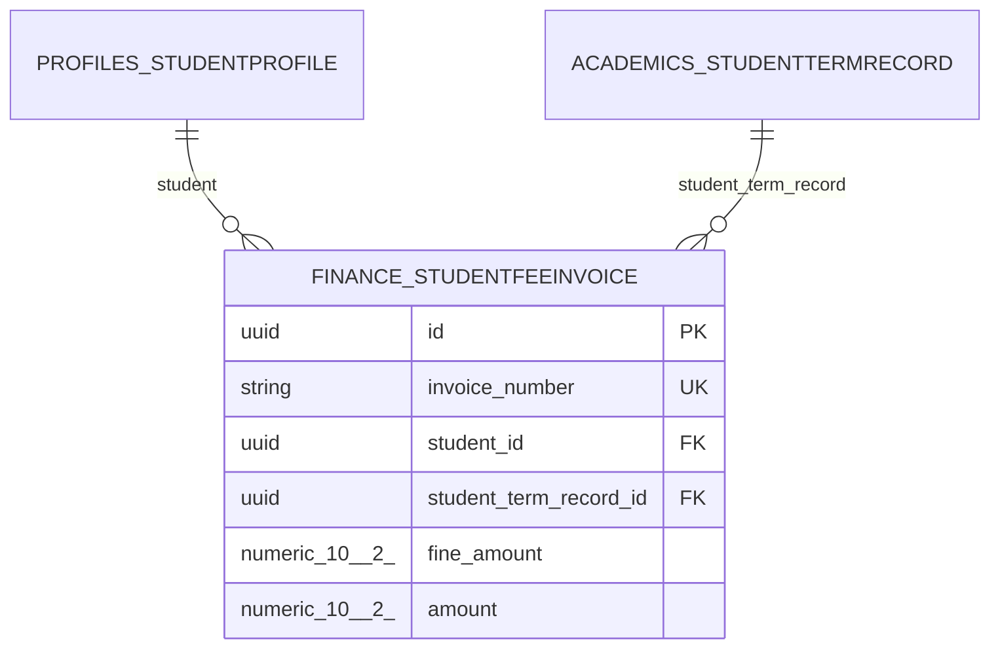

### finance.StudentFeeInvoice

Student invoice linked to a StudentTermRecord, with unique invoice number, amount, optional fine, due date, free-form fee type, and payment status. There is no separate payment/transaction model. The database does not verify that student matches the student on student_term_record.

**Table:** `finance_studentfeeinvoice` · **Placement:** Each tenant database only

**Source:** [models.py](../apps/finance/models.py)

| Column | Django type → PostgreSQL | NULL | Keys / indexes | Default and field rules |
| --- | --- | --- | --- | --- |
| `id` | `UUIDField` → `uuid` | no | PK | default `uuid.uuid4` |
| `created_at` | `DateTimeField` → `timestamp with time zone` | no | — | auto_now_add; blank=True |
| `updated_at` | `DateTimeField` → `timestamp with time zone` | no | — | auto_now; blank=True |
| `invoice_number` | `CharField` → `varchar(20)` | no | UNIQUE | — |
| `student_id` | `ForeignKey` → `uuid` | no | FK, indexed | — |
| `student_term_record_id` | `ForeignKey` → `uuid` | no | FK, indexed | — |
| `fine_amount` | `DecimalField` → `numeric(10, 2)` | yes | — | blank=True |
| `amount` | `DecimalField` → `numeric(10, 2)` | no | — | — |
| `payment_status` | `CharField` → `varchar(20)` | no | — | default `PENDING`; choices: `PAID`, `UNPAID`, `OVERDUE`, `PENDING`, `WAIVED` |
| `fee_type` | `CharField` → `varchar(50)` | no | — | — |
| `due_date` | `DateField` → `date` | no | — | — |

**Foreign keys and reverse accessors**

- `student` → `profiles.StudentProfile` (`profiles_studentprofile`); `CASCADE`; reverse `fee_invoices`.
- `student_term_record` → `academics.StudentTermRecord` (`academics_studenttermrecord`); `CASCADE`; reverse `fee_invoices`.

**Field meaning**

- `invoice_number`: Unique identifier for the fee invoice (e.g., INV-2024-0001)
- `fine_amount`: Fine amount for late fee payment or other penalties
- `payment_status`: Payment status of the invoice (e.g., pending, paid, overdue)
- `fee_type`: Type of fee (e.g., tuition, library, lab, etc.)
- `due_date`: Due date for fee payment

## 12. Django admin and sessions

These built-in Django tables are main-database-only. Admin logs therefore cannot use a tenant-local user row as a cross-database foreign key. The middleware/router combination should be considered when exposing admin or session-based authentication on a tenant host.

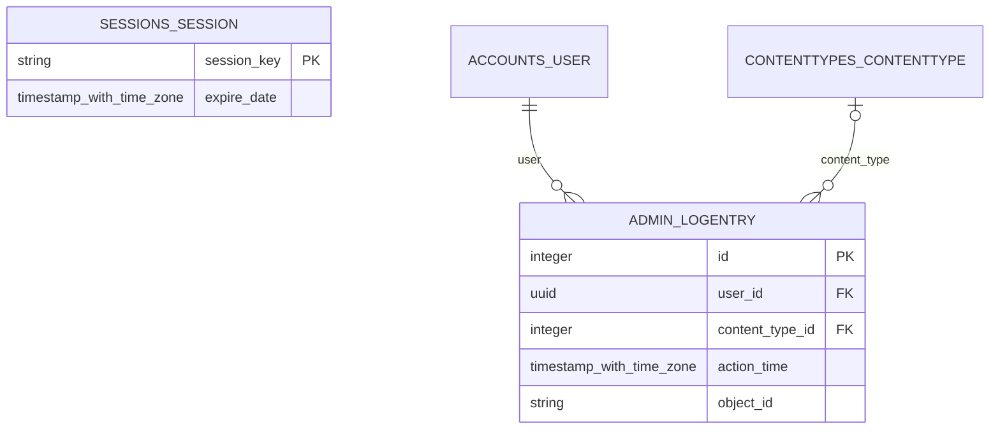

### admin.LogEntry

Django admin change history in the main database. user is a real FK to accounts.User; content_type is optional. object_id is text and can describe a UUID, but is not a foreign key to the changed object. There is no enforced generic relationship to the target table.

**Table:** `django_admin_log` · **Placement:** Main database only

| Column | Django type → PostgreSQL | NULL | Keys / indexes | Default and field rules |
| --- | --- | --- | --- | --- |
| `id` | `AutoField` → `integer` | no | PK | blank=True |
| `action_time` | `DateTimeField` → `timestamp with time zone` | no | — | default `django.utils.timezone.now` |
| `user_id` | `ForeignKey` → `uuid` | no | FK, indexed | — |
| `content_type_id` | `ForeignKey` → `integer` | yes | FK, indexed | blank=True |
| `object_id` | `TextField` → `text` | yes | — | blank=True |
| `object_repr` | `CharField` → `varchar(200)` | no | — | — |
| `action_flag` | `PositiveSmallIntegerField` → `smallint` | no | — | choices: `1`, `2`, `3` |
| `change_message` | `TextField` → `text` | no | — | blank=True |

**Foreign keys and reverse accessors**

- `user` → `accounts.User` (`accounts_user`); `CASCADE`; reverse `logentry_set`.
- `content_type` → `contenttypes.ContentType` (`django_content_type`); `SET_NULL`; reverse `logentry_set`.

**Default ORM ordering:** `-action_time`. This is query ordering, not physical storage order.

### sessions.Session

Django database-backed session store. The session key is the primary key; session_data is encoded data, not JSON. There is no user foreign key. Authenticated session data can contain a user identifier and backend, resolved by Django during authentication. Sessions are main-database-only under this router.

**Table:** `django_session` · **Placement:** Main database only

| Column | Django type → PostgreSQL | NULL | Keys / indexes | Default and field rules |
| --- | --- | --- | --- | --- |
| `session_key` | `CharField` → `varchar(40)` | no | PK | — |
| `session_data` | `TextField` → `text` | no | — | — |
| `expire_date` | `DateTimeField` → `timestamp with time zone` | no | indexed | — |

## 13. JWT token persistence

Simple JWT’s blacklist app contributes these tables to the main database and each tenant. Configured refresh-token rotation and BLACKLIST_AFTER_ROTATION=True use this persistence layer. Expired token rows can be removed with Simple JWT’s flushexpiredtokens command in the appropriate database context.

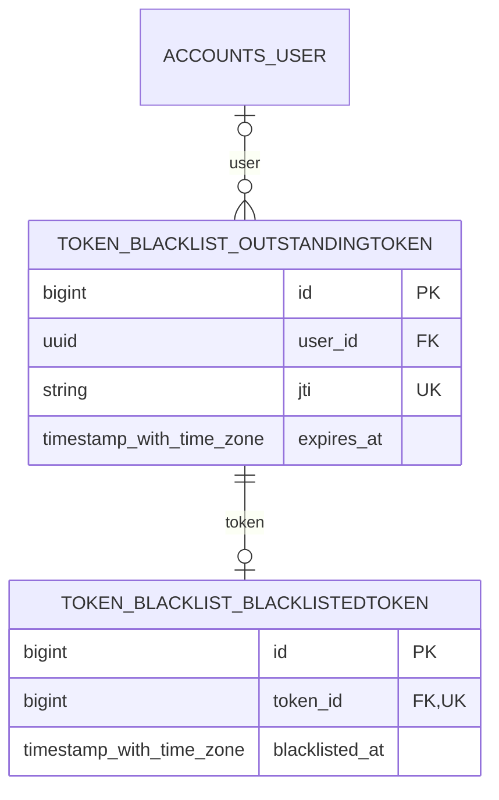

### token_blacklist.OutstandingToken

Simple JWT refresh/sliding-token tracking. jti is unique, token stores the serialized token, and user is optional with SET_NULL on deletion. This table tracks outstanding tokens; normal access-token authentication does not require one row for every access token.

**Table:** `token_blacklist_outstandingtoken` · **Placement:** Main + each tenant database

| Column | Django type → PostgreSQL | NULL | Keys / indexes | Default and field rules |
| --- | --- | --- | --- | --- |
| `id` | `BigAutoField` → `bigint` | no | PK | blank=True |
| `user_id` | `ForeignKey` → `uuid` | yes | FK, indexed | blank=True |
| `jti` | `CharField` → `varchar(255)` | no | UNIQUE | — |
| `token` | `TextField` → `text` | no | — | — |
| `created_at` | `DateTimeField` → `timestamp with time zone` | yes | — | blank=True |
| `expires_at` | `DateTimeField` → `timestamp with time zone` | no | — | — |

**Foreign keys and reverse accessors**

- `user` → `accounts.User` (`accounts_user`); `SET_NULL`; reverse `outstandingtoken_set`.

**Default ORM ordering:** `user`. This is query ordering, not physical storage order.

### token_blacklist.BlacklistedToken

Blacklist marker with a one-to-one reference to an OutstandingToken. At most one blacklist entry exists per outstanding token; deleting that outstanding row cascades to its blacklist marker. Rotation and blacklisting settings are configured in settings.py.

**Table:** `token_blacklist_blacklistedtoken` · **Placement:** Main + each tenant database

| Column | Django type → PostgreSQL | NULL | Keys / indexes | Default and field rules |
| --- | --- | --- | --- | --- |
| `id` | `BigAutoField` → `bigint` | no | PK | blank=True |
| `token_id` | `OneToOneField` → `bigint` | no | UNIQUE, FK | — |
| `blacklisted_at` | `DateTimeField` → `timestamp with time zone` | no | — | auto_now_add; blank=True |

**Foreign keys and reverse accessors**

- `token` → `token_blacklist.OutstandingToken` (`token_blacklist_outstandingtoken`); `CASCADE`; reverse `blacklistedtoken`.

## 14. Migration bookkeeping and migration inventory

### django.db.migrations.recorder.Migration

Django's migration recorder creates this infrastructure table separately from the normal installed-model registry. It exists in every database that has been migrated, including tenant databases.

**Table:** `django_migrations`

| Column | PostgreSQL type | NULL | Rules |
| --- | --- | --- | --- |
| `id` | `bigint` | no | Auto-generated BigAutoField primary key in Django 6.0 |
| `app` | `varchar(255)` | no | App label |
| `name` | `varchar(255)` | no | Migration name without `.py` |
| `applied` | `timestamp with time zone` | no | Python default `django.utils.timezone.now` |

There are no foreign keys, custom indexes, or declared unique constraint on `(app, name)`. A recorder entry means Django processed a migration for that database; the router may have skipped individual model operations. Do not infer the presence of every app table from migration history alone.

### Project migration inventory

Migration files are under each app's `migrations/` directory. These are the checked-in files, not a statement about deployment status.

| App | Migration files in order |
| --- | --- |
| `accounts` | [`0001_initial`](../apps/accounts/migrations/0001_initial.py) |
| `tenants` | [`0001_initial`](../apps/tenants/migrations/0001_initial.py) |
| `profiles` | [`0001_initial`](../apps/profiles/migrations/0001_initial.py)<br>[`0002_alter_studentprofile_section`](../apps/profiles/migrations/0002_alter_studentprofile_section.py) |
| `academics` | [`0001_initial`](../apps/academics/migrations/0001_initial.py)<br>[`0002_initial`](../apps/academics/migrations/0002_initial.py)<br>[`0003_alter_course_code`](../apps/academics/migrations/0003_alter_course_code.py)<br>[`0004_rename_max_students_per_section_batch_per_section_capacity_and_more`](../apps/academics/migrations/0004_rename_max_students_per_section_batch_per_section_capacity_and_more.py)<br>[`0005_alter_curriculum_program_and_more`](../apps/academics/migrations/0005_alter_curriculum_program_and_more.py)<br>[`0006_alter_academicpolicy_options_and_more`](../apps/academics/migrations/0006_alter_academicpolicy_options_and_more.py) |
| `enrollments` | [`0001_initial`](../apps/enrollments/migrations/0001_initial.py)<br>[`0002_remove_courseoffering_unique_course_offering_and_more`](../apps/enrollments/migrations/0002_remove_courseoffering_unique_course_offering_and_more.py)<br>[`0003_courseoffering_capacity`](../apps/enrollments/migrations/0003_courseoffering_capacity.py) |
| `attendance` | [`0001_initial`](../apps/attendance/migrations/0001_initial.py) |
| `examinations` | [`0001_initial`](../apps/examinations/migrations/0001_initial.py) |
| `finance` | [`0001_initial`](../apps/finance/migrations/0001_initial.py) |

`core` and `storage` have no schema migrations beyond their package initializers. Academic/profile dependencies are split across initial migrations to resolve cross-app relationships. Academic migrations rename `StudentTermRecord.gpa` to `sgpa`, adjust related names and curriculum relations, and rename the batch section-capacity field. Enrollment migrations evolve offering uniqueness and add capacity; profile migration 0002 makes student section optional.

### Installed package migration endpoints

| App | Latest migration in the inspected installation |
| --- | --- |
| `admin` | `0003_logentry_add_action_flag_choices` |
| `auth` | `0012_alter_user_first_name_max_length` |
| `contenttypes` | `0002_remove_content_type_name` |
| `sessions` | `0001_initial` |
| `token_blacklist` | `0013_alter_blacklistedtoken_options_and_more` |

The auth migration names include historical User changes; `AUTH_USER_MODEL = "accounts.User"` swaps out Django's default user table. The custom user migration creates the actual account table and its two automatic join tables.

### Applying changes

Run these commands with the project's configured environment and database configuration:

```bash
# Inspect model changes and create migration files after an intentional schema change.
python manage.py makemigrations

# Apply global/shared operations to the main database.
python manage.py migrate --database=default

# Register each university connection and migrate its shared/tenant tables.
python manage.py migrate_tenants
```

[migrate_tenants](../apps/tenants/management/commands/migrate_tenants.py) reads **all** University rows, including inactive universities, configures their connection aliases, and calls `migrate` for each. It expects the target databases to exist and be accessible; it does not provision PostgreSQL databases. It catches failures per university and continues, so inspect each tenant's result rather than relying on the final success message alone.

For this documentation, an offline Django migration autodetector comparison found **no changes** between the loaded models and the final checked-in migration state. No database connection or migration execution was needed for that comparison.

## 15. Integrity boundaries and implementation caveats

This section distinguishes documented intent from constraints that the current schema actually enforces.

| Area | Current enforcement / limitation |
| --- | --- |
| ClassSession Meta blocks | The two extra `class Meta` declarations in attendance/models.py are at module scope. The intended session uniqueness, end-after-start check, three composite indexes, and ordering are not attached to ClassSession and are absent from its migration state. Ordinary field indexes on session_date and status still exist. |
| Primary domain | `one_primary_per_portal` is a nonunique index. Signals demote existing primary domains when creating a new UniversityPortal's default domain, but no partial unique constraint guarantees one primary domain per portal for other writes. |
| AttendancePolicy nullable scopes | The conditional unique key on `(term, program)` for active policies uses PostgreSQL's default NULL-distinct behavior. It prevents duplicate active fully specified scopes but allows duplicate global, term-only, or program-only scopes. |
| AcademicPolicy singleton | No database singleton constraint exists. UUIDs are assigned before save(), so the `not self.pk` guard can miss new rows. Instance delete() is blocked, but queryset deletion and raw SQL are separate paths. |
| Academic dates and totals | The database does not check calendar ordering, prerequisite acyclicity, capacity totals, minimum/maximum faculty credits, curriculum credit sums, grade-band overlaps, or a complete 100% assessment weighting. |
| Student placement | Separate FKs do not verify that StudentProfile.section belongs to StudentProfile.batch, or that a batch's curriculum belongs to its program. |
| Enrollment and teaching eligibility | Foreign keys do not enforce that an enrolled student belongs to the offering's section or that an assigned faculty member has a matching FacultyCourse row. Services must apply those rules. |
| Attendance consistency | Enrollment's offering must match ClassSession's offering, and a session's FacultyAssignment should belong to that offering. Independent foreign keys do not enforce these equalities. |
| Marks consistency | StudentAssessment references a student directly. Database constraints do not require enrollment or bound obtained marks by total marks. |
| Invoice consistency | student must match student_term_record.student at the application layer. Amount and fine fields do not have custom nonnegative validators or check constraints. |
| Audit retention | AttendanceLog is not protected against modification and cascades with AttendanceRecord. Admin object_id does not reference the target object with a foreign key. |
| User/profile roles | One-to-one fields prevent duplicate profiles of a given type but do not require every user to have a profile, forbid multiple role profiles, or synchronize profiles with groups. |
| Sessions versus tenants | Session rows and admin logs live in default; custom accounts are database-local. There is no cross-database user FK or automatic global identity mapping. JWT is the configured DRF authentication mechanism. |
| Model flags and workflow | Flags such as marks_submitted, is_locked, is_attendance_marked, and payment_status store state. The database does not itself run workflow transitions, lock editing, regenerate summaries, send notifications, or create audit entries. |
| Files and JSON | Cloudinary public IDs reference external resources without database-enforced existence checks. JSONField is PostgreSQL jsonb; its internal structure is application-defined. |

### Deletion and history

Most project relationships use ORM CASCADE, so deletion can reach large subgraphs. PROTECT specifically guards student batch/section references, batch curriculum/admission term, assessment types used by policies or assessments, and attendance records' enrollment references. SET_NULL preserves rows when optional department heads, faculty departments, session faculty assignments, audit actors, JWT users, or admin content types disappear. A protected row reached through a cascade can prevent the wider deletion; do not assume a parent cascade bypasses PROTECT.

## 16. Keeping this document current

When a model changes, update its field dictionary, the matching domain diagram, the coverage count if necessary, and the migration inventory. Include inherited fields and any automatic through tables. Keep physical database placement aligned with the router, not merely with app names or architectural intent.

A useful verification sequence is to load Django's model registry with `include_auto_created=True`, compare every concrete field and through model against this document, and compare the migration loader's final ProjectState with the model state. Use `makemigrations --check --dry-run` in the project's normal environment when validating model/migration consistency. Inspect deployment migration status separately; a source-level check does not establish live database state.

Django reference: [model fields](https://docs.djangoproject.com/en/6.0/ref/models/fields/), [model options](https://docs.djangoproject.com/en/6.0/ref/models/options/), [authentication models](https://docs.djangoproject.com/en/6.0/ref/contrib/auth/), [content types](https://docs.djangoproject.com/en/6.0/ref/contrib/contenttypes/), [database routing](https://docs.djangoproject.com/en/6.0/topics/db/multi-db/), and [sessions](https://docs.djangoproject.com/en/6.0/topics/http/sessions/).
